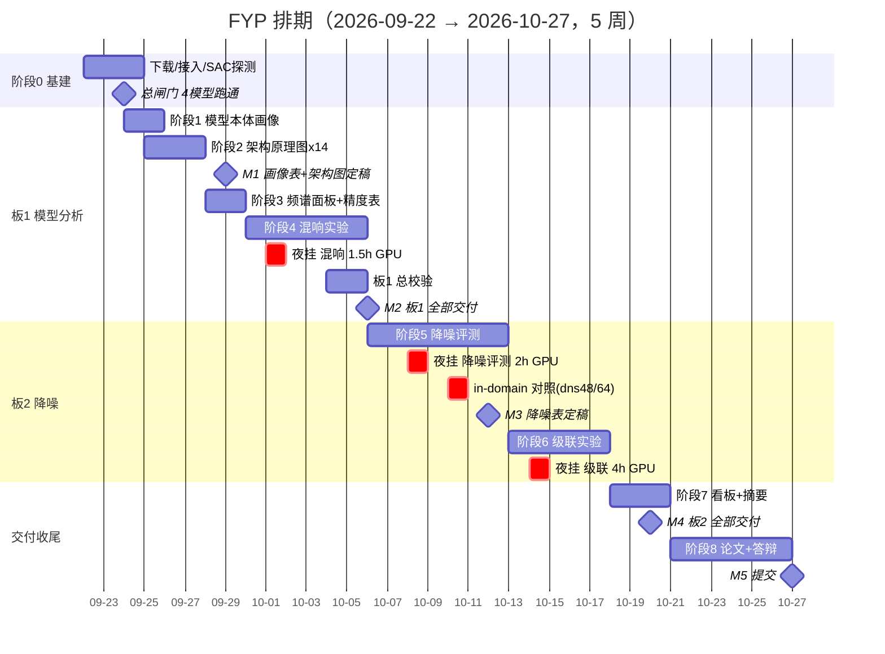
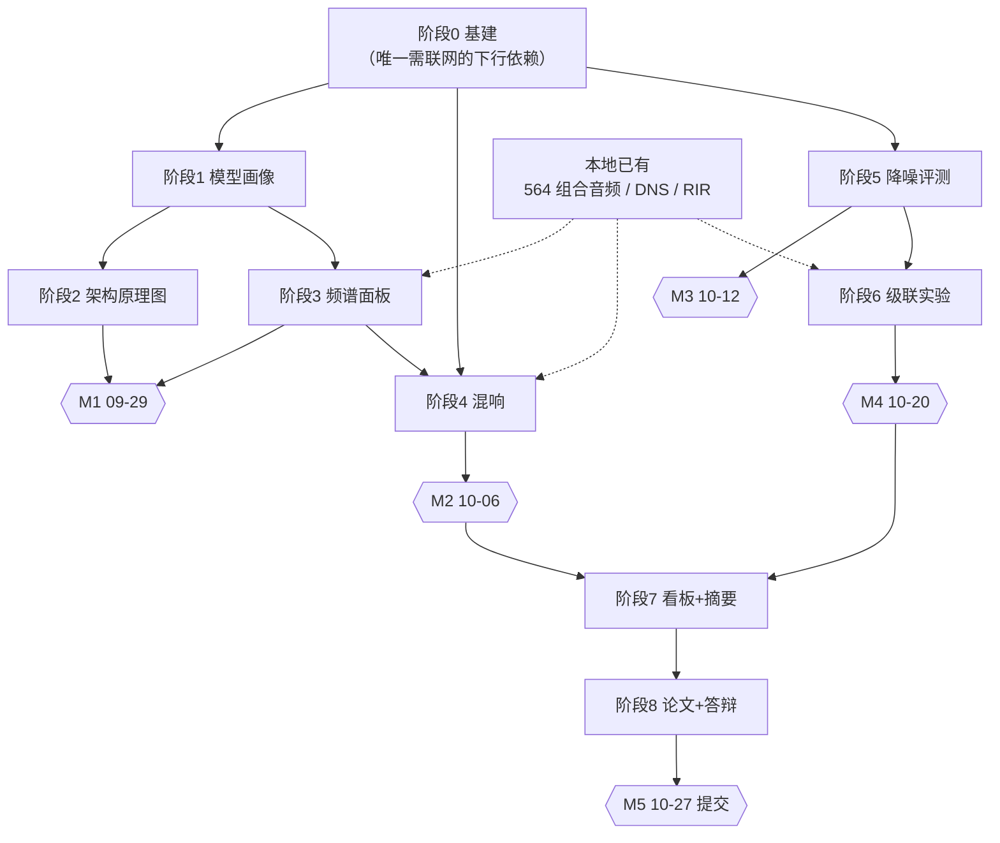

# FYP 项目计划与任务拆解

> 版本：v1.0 ｜ 制定日：2026-09-22（周二）｜ 项目根：`E:\FYP_HKBU`
> 目标交付日：**2026-10-27（周二）**，共 5 周
> 配套技术文档：`FYP_ROADMAP_2026-09-22.md`（讲"做什么、为什么"）；**本文件讲"谁在什么时候交付什么、怎么验收"**
> 原则：所有指标**本机实测**；任何跨模型比较先声明口径；坏消息优先暴露。

---

## 0. 一页纸总览

### 0.1 已确认的项目前提（本次取证）

| 项 | 取值 | 来源 |
|---|---|---|
| 硬性交付期 | **2026-10-27**（约 5 周） | 本次确认 |
| 挂机窗口 | **可通宵**（每晚 6~10 h 连续可用） | 本次确认 |
| 人力 | 单人（你）+ AI 助手执行 | 既有事实 |
| 计算资源 | RTX 4070 Laptop 8 GiB；E: 剩 **62 GB** / C: 剩 **400 GB** | 本机实测 |
| 网络 | GitHub / HuggingFace / Edinburgh DataShare 可达 | 已验证 |

### 0.2 两个板块与 5 个里程碑

| 里程碑 | 日期 | 验收物（一句话） |
|---|---|---|
| **M1** | 2026-09-29 | 模型画像表（16 模型）+ 14 张架构原理图定稿 |
| **M2** | 2026-10-06 | 频谱面板系列 + 混响实验完成 → **板 1 全部交付** |
| **M3** | 2026-10-12 | 降噪双口径评测表定稿（含 in-domain 对照） |
| **M4** | 2026-10-20 | 级联实验结论 + 3 个离线看板 → **板 2 全部交付** |
| **M5** | 2026-10-27 | 论文图表 + 答辩材料 + 全链路复现性检查 → **提交** |

### 0.3 只在 3 个夜里挂 GPU

| 夜 | 实验 | GPU 时长 |
|---|---|---|
| 第 1 夜（10-01） | 混响 / 去混响 | ~1.5 h |
| 第 2 夜（10-08） | 降噪评测 | ~2 h |
| 第 3 夜（10-14） | 级联实验 | ~4 h |

**总计约 7.5 h GPU，分散在 3 个夜里**——这是本项目唯一的串行硬约束，其余工作全是 CPU/出图/写作，可白天推进。

---

## 1. 范围定义

### 1.1 在范围内（In Scope）

1. **板 1 源分离模型分析**：模型容量画像（参数/FLOPs/显存/时延）、架构原理图、信号级频谱面板、混响/去混响/去回声实验
2. **板 2 降噪**：`facebookresearch/denoiser` + `Mel-RoFormer-Denoise-Aufr33` 在 Valentini + DNS 上的评测；**降噪→分离级联实验**
3. **交付形态**：论文可用图表 + 3 个离线 HTML 看板 + 4 份数据摘要 + 答辩材料 + 可复现脚本

### 1.2 明确不在范围内（Out of Scope，防止范围蔓延）

| 不做 | 原因 |
|---|---|
| **降噪模型微调** | 已拍板不做（会破坏与 pretrained 的可比性） |
| **补跑 BSRNN-SIMO 的 36 首** | 已拍板暂不补 → 保留 14/50，报告显式标注截断 |
| 复现 RPCA+DRNN | 论文未公开代码（09-19 审计结论） |
| 复现 Pac-HuBERT-SEP | MERL 未发布 |
| 逐格对齐参考论文数值 | 需原版 Demucs(v1) + 官方 DPRNN-TasNet 权重，成本高收益低（详见路线图 §7） |
| lyrics-game 子项目 | 与主线无代码耦合，P3 待办 |

> ⚠️ **范围变更须走流程**：任何新增实验，先问三个问题——① 是否影响 M1~M5 中任一里程碑？② 砍掉什么来换？③ 谁批准？三个都答不上就不做。

---

## 2. 交付物清单与完成定义（DoD）

### 2.1 板 1 交付物

| # | 交付物 | 落点 | DoD（怎么算"做完了"） |
|---|---|---|---|
| D1 | 模型画像表 | `data/model_analysis/model_profile.csv` | 16 行**零缺失**；FLOPs 与 thop 交叉验证偏差 <5%，超标的逐条标注 |
| D2 | 架构原理图 ×14 | `figures/model_arch/*.png` | 每张图的 shape 标注能在 `graph_*.json` 溯源；参数量占比之和 = 100% |
| D3 | 频谱面板系列 | `figures/spectrograms/*.png` | 3 首歌 × 6 面板统一色标；BSS-Eval 四分量之和与估计的残差 ≈ 0 |
| D4 | 混响实验图组 | `figures/reverb/*.png` | RIR 本体图 + 6 面板 + T60→ΔSDR 退化曲线齐全 |
| D5 | 精度表（参考表样式） | `docs/MEDIAN_TABLE*.md` 重绘版 | 主副表分明；脚注写明口径与参考表差异原因 |

### 2.2 板 2 交付物

| # | 交付物 | 落点 | DoD |
|---|---|---|---|
| D6 | 降噪评测表 | `data/denoise/denoise_eval.csv` | **双口径分开报**；**in-domain 对照（dns48/dns64 vs master64）必须在表内** |
| D7 | 降噪图组 | `figures/denoise/*.png` | 频谱前后对比 + 指标条形 + dry/wet 曲线 |
| D8 | 级联 ΔSDR 矩阵 | `data/cascade/cascade_eval.csv` | L0×L1×L2×L3 × 4 SNR 全格填满；每格标注可复现命令 |
| D9 | 级联图组 | `figures/cascade/*.png` | 按 SNR 分箱的 ΔSDR 图；含"变差也是结论"的显式说明 |

### 2.3 收尾交付物

| # | 交付物 | 落点 | DoD |
|---|---|---|---|
| D10 | 3 个离线看板 | `html/model_analysis_dashboard.html` 等 | **双击即可开**，图片内嵌，无任何外部依赖 |
| D11 | 4 份数据摘要 | `docs/MODEL_PROFILE_*.md` 等 | 数字可与 CSV 逐一对齐，可被论文直接引用 |
| D12 | 论文图表包 | 论文正文插图 | 全部 300 dpi，图注含口径三要素（数据集/片段/指标定义） |
| D13 | 答辩材料 | `slides/` | 能 15 分钟讲完"模型怎么运行 + 两板块怎么缝合" |
| D14 | 复现性检查 | 项目根 `README.md` + 一键脚本 | 他人按 README 能复跑任一图表 |

---

## 3. WBS 任务拆解

> 负责人：**助手** = AI 执行；**你** = 决策与验收；**导师** = 待确认项。
> 预估工时以"助手执行 + 你验收"计；GPU 时长单列。

### 阶段 0 · 基建与准入（2026-09-22 夜 ~ 09-24）

| ID | 任务 | 产出 | 负责人 | 依赖 | 验收标准 | 预估 |
|---|---|---|---|---|---|---|
| T0.1 | 下载 Valentini testset（163+147 MB） | `02_databases/Valentini/` | 助手 | 无 | 824 noisy + 824 clean **配对**齐全 | 20 min |
| T0.2 | 下载 Valentini 28spk trainset（≈5 GB） | 同上 | 助手 | T0.1 | 文件数与官方清单一致 | 1 h（后台） |
| T0.3 | clone `facebookresearch/denoiser` + 装进 venv | `01_models/_third_party/denoiser` | 助手 | 无 | ① `import denoiser` 成功 ② **SAC 功能性探测通过**（不信历史记录） | 40 min |
| T0.4 | 下载 Mel-RoFormer-Denoise 2 个 ckpt（1.8 GB）+ yaml | `01_models/_weights/` | 助手 | 无 | 逐键 load `missing=0 / unexpected=0` | 1 h（后台） |
| T0.5 | 下载 2 个去混响/去回声 ckpt | 同上 | 助手 | 无 | 同上 | 1 h（后台） |
| T0.6 | 确认 ZFTurbo clone 含 `mel_band_roformer` denoise 配置，缺则升级 | — | 助手 | 无 | 能加载 D6 的 yaml | 30 min |
| T0.7 | 建目录骨架（5 figures + 4 data） | 空目录 | 助手 | 无 | 路径符合落点规则 | 10 min |

**阶段 0 总闸门**：4 个新模型（denoiser ×2 ckpt + denoise-Mel-RoFormer ×2 + dereverb ×2）**各自跑通一次 10 s 前向并落盘 wav**，且结果 JSON 里 `status = PASS`。
> 🔴 判成功**只看结果 JSON 的 status**，不看目录是否存在、不看返回码（本项目踩过"假 PASS"）。

### 阶段 1 · 模型本体画像（09-24 ~ 09-25）

| ID | 任务 | 产出 | 负责人 | 依赖 | 验收标准 | 预估 |
|---|---|---|---|---|---|---|
| T1.1 | 写 `_measure_model_profile.py`（**复用** `benchmark_model_universal.py::REGISTRY` 的 loader） | 脚本 | 助手 | 阶段 0 | 不重写加载链路（防口径分裂） | 2 h |
| T1.2 | 静态量：参数量 / 权重体积 / 输出轨数 / 采样率 | CSV 列 | 助手 | T1.1 | 16 模型全覆盖 | 30 min |
| T1.3 | FLOPs：`FlopCounterMode` 实测 + thop 交叉验证 | CSV 列 | 助手 | T1.1 | 偏差 <5%，超标的标注 | 1 h |
| T1.4 | 峰值显存 + 单次前向时延（预热 5 次取中位） | CSV 列 | 助手 | T1.1 | 显存取 `max_memory_allocated` | 1 h |
| T1.5 | 出图：`params_flops.png`（双轴）+ `profile_pareto.png`（气泡） | 2 PNG | 助手 | T1.2–T1.4 | 分组呈现（四轨/单目标/解析组） | 1 h |

**口径写死**：44.1 kHz 立体声、输入 **10 s**、FLOPs 按 **2×MACs**、RTF 标注机器负载。

### 阶段 2 · 架构原理图 ×14（09-25 ~ 09-27）

| ID | 任务 | 产出 | 负责人 | 依赖 | 验收标准 | 预估 |
|---|---|---|---|---|---|---|
| T2.1 | `_extract_model_graph.py`：forward hook 抓真实层级与 shape | `graph_*.json` ×14 | 助手 | T1.1 | 含（模块类名/输入 shape/输出 shape/参数量）完整树 | 3 h |
| T2.2 | `_plot_model_arch.py`：左概念流程 + 右真实层级条带 | 渲染器 | 助手 | T2.1 | 数据驱动，非手绘想象 | 3 h |
| T2.3 | 14 张图逐张自查（你参与） | 14 PNG | 你 + 助手 | T2.2 | shape 可溯源；占比和=100%；角标有论文引用+本机路径 | 2 h |
| T2.4 | 补变换层直观图（复用既有 `fig3/fig4_spectrogram_*`） | 引用 | 助手 | — | 不重复造图 | 30 min |

### 阶段 3 · 频谱面板 + 精度表重绘（09-28 ~ 09-29，**零推理**）

| ID | 任务 | 产出 | 负责人 | 依赖 | 验收标准 | 预估 |
|---|---|---|---|---|---|---|
| T3.1 | `_make_spectrogram_panels.py`（读 `03_outputs/_test_run/`，不重推理） | 脚本 | 助手 | 无 | 直接复用 564 组合音频 | 2 h |
| T3.2 | 6 面板：Mixture/Target/Estimate/Interference/Artifacts/多模型并排 | PNG ×3 歌 | 助手 | T3.1 | **BSS-Eval 四分量之和 ≈ 估计**（残差校验） | 2 h |
| T3.3 | 机制图：掩码可视化 + band-split 频带边界 | PNG | 助手 | T3.1 | 能看出"模型怎么切的" | 1.5 h |
| T3.4 | 按参考表样式重绘 Average SDR 表 + 脚注口径 | MD + PNG | 助手 | 无 | 主表用本机实测；脚注说明与参考表差异 | 1.5 h |

### 阶段 4 · 混响 / 去混响 / 去回声（09-30 ~ 10-05，**夜挂 1.5 h GPU**）

| ID | 任务 | 产出 | 负责人 | 依赖 | 验收标准 | 预估 |
|---|---|---|---|---|---|---|
| T4.1 | `_reverb_experiment.py` + RIR 选取（小房间 T60≈0.6 s / 大厅 T60≈1.2 s，**源文件口径**） | 脚本 + RIR 清单 | 助手 | 阶段 0 | 用本机 60248 条 RIR | 2 h |
| T4.2 | 四段生成：干 / 加混响 / 去混响输出 / 残差 | 音频 | 助手 | T4.1 | 3 歌 × 2 档 | — |
| T4.3 | **夜挂**：84 组合推理 | 结果 JSON | 助手 | T4.2 | 独立结果文件，不污染主表 | 1.5 h GPU |
| T4.4 | RIR 本体图（波形 + 能量衰减 EDT/T30） | PNG | 助手 | T4.3 | 这才配叫 Reverberation | 1.5 h |
| T4.5 | T60 → ΔSDR 退化曲线（现有 12 模型） | PNG | 助手 | T4.3 | 分模型曲线 | 1.5 h |
| T4.6 | 回声实验：人工延迟回声 → de-echo 前后 | PNG | 助手 | T4.1 | 对应 Target Echo 面板 | 1.5 h |
| T4.7 | **板 1 总校验**：口径/脚注/可溯源 | 检查清单 | 你 + 助手 | T1–T4 | 每条数字能指到 CSV | 2 h |

### 阶段 5 · 降噪评测（10-06 ~ 10-12，**夜挂 2 h GPU**）

| ID | 任务 | 产出 | 负责人 | 依赖 | 验收标准 | 预估 |
|---|---|---|---|---|---|---|
| T5.1 | `_denoise_eval.py` 统一入口（服务工具 A/B × 两数据集） | 脚本 | 助手 | 阶段 0 | 一个入口，不分叉 | 3 h |
| T5.2 | **主口径**（统一 16 kHz）：PESQ-WB / STOI / SI-SDR | CSV | 助手 | T5.1 | 跨模型唯一公平比较处 | 1.5 h |
| T5.3 | **副口径**（原生率）：SI-SDR / LSD / Mel 距离 | CSV | 助手 | T5.1 | PESQ/STOI 在此不适用，须标注 | 1.5 h |
| T5.4 | ⚠️ **in-domain 对照**：`master64` vs `dns48`/`dns64` | CSV 列 | 助手 | T5.2 | **必进表**，否则结论站不住 | 1 h |
| T5.5 | dry/wet 曲线（denoiser `--dry`） | PNG | 助手 | T5.2 | 降噪强度 vs 指标 | 1 h |
| T5.6 | 频谱前后对比图组 | PNG | 助手 | T5.2 | 4 组（2 工具 × 2 数据集） | 1.5 h |

> ✅ **T5.1–T5.6 全部完成（09-23）**，入口 `tools/_denoise_eval.py` +
> `_denoise_drywet.py` + `_plot_denoise*.py`，产出见
> `denoiser/docs/T5_DENOISE_STRATIFIED.md`（主表）与
> `denoiser/docs/T5_5_T5_6_DRYWET_AND_SPECTRA.md`（强度曲线 + 频谱图组）。
> 全量 16575 cells（dns_dev 4335 + synth 4000 + valentini 16k 4120 + valentini 44.1k 4120），err = 0。
> ⚠️ 全部结果建立在 **P19 采样率契约修复后**口径上；P11 / P16 的旧结论已作废，
> 见 `denoiser/docs/P19_SAMPLE_RATE_CONTRACT_BUG.md`。

### 阶段 6 · 级联实验（10-13 ~ 10-17，**夜挂 4 h GPU**）

| ID | 任务 | 产出 | 负责人 | 依赖 | 验收标准 | 预估 |
|---|---|---|---|---|---|---|
| T6.1 | 造测试集：MUSDB test 取 10 首 × 4 SNR 加 DNS 噪声 | noisy 音频 + GT | 助手 | T5.1 | 有 GT，可算 ΔSDR | 1.5 h |
| T6.2 | **夜挂**：L0/L1/L2/L3 × 4 模型（Demucs/MDX/BSRNN-opt/UMX） | 结果 JSON | 助手 | T6.1 | 640 组合 | 4 h GPU |
| T6.3 | ΔSDR 矩阵 + 按 SNR 分箱图 | CSV + PNG | 助手 | T6.2 | 每格标可复现命令 | 2 h |
| T6.4 | 诚实性检查：结果变差也照报 | 结论段 | 你 + 助手 | T6.3 | 明确写出域外泛化结论 | 1 h |

### 阶段 7 · 看板与摘要（10-18 ~ 10-20）

| ID | 任务 | 产出 | 负责人 | 依赖 | 验收标准 | 预估 |
|---|---|---|---|---|---|---|
| T7.1 | 看板 1：模型分析 | HTML | 助手 | 阶段 1–4 | 离线可开、图内嵌 | 2 h |
| T7.2 | 看板 2 + 3：降噪 / 级联 | HTML ×2 | 助手 | 阶段 5–6 | 同上 | 3 h |
| T7.3 | 4 份数据摘要 docs | MD ×4 | 助手 | 各阶段 | 数字与 CSV 对齐 | 2 h |

### 阶段 8 · 论文与答辩收尾（10-21 ~ 10-27）

| ID | 任务 | 产出 | 负责人 | 依赖 | 验收标准 | 预估 |
|---|---|---|---|---|---|---|
| T8.1 | 图表入论文（板 1） | 论文插图 | 助手 | M2 | 300 dpi + 口径三要素图注 | 3 h |
| T8.2 | 图表入论文（板 2） | 论文插图 | 助手 | M4 | 同上 | 3 h |
| T8.3 | 口径与差异说明章节 | 论文章节 | 助手 | T8.1–T8.2 | 挡掉"为什么和参考表不一样"的提问 | 2 h |
| T8.4 | 答辩 Slides | `slides/` | 助手 + 你 | T8.1–T8.3 | 15 分钟讲完两板块 | 3 h |
| T8.5 | 全链路复现性检查 | README + 一键脚本 | 助手 | 全部 | 按 README 能复跑任一图 | 2 h |
| T8.6 | 最终校对与提交 | — | 你 | T8.5 | M5 | — |

---

## 4. 排期

### 4.1 甘特图



### 4.2 周历（逐日）

| 日期 | 星期 | 主任务 | 夜间 |
|---|---|---|---|
| 09-22 | 二 | **今晚即可启动 T0.1/T0.3/T0.4/T0.5 下载** | 下载（无 GPU） |
| 09-23 | 三 | 阶段 0 接入 + SAC 探测；T1.1 写脚本 | 下载续 |
| 09-24 | 四 | **阶段 0 总闸门** + T1.2–T1.4 | — |
| 09-25 | 五 | T1.5 出图 + T2.1 起步 | — |
| 09-26 | 六 | T2.1–T2.2 完成 | — |
| 09-27 | 日 | T2.3 你逐张验收（14 图） | — |
| 09-28 | 一 | T3.1–T3.2 频谱面板 | — |
| 09-29 | 二 | **M1 评审** + T3.4 精度表重绘 | — |
| 09-30 | 三 | T4.1 混响脚本 + RIR 选取 | — |
| 10-01 | 四 | T4.2 四段生成 | **混响 1.5 h GPU** |
| 10-02 | 五 | T4.4 RIR 本体图 | — |
| 10-03 | 六 | T4.5 退化曲线 + T4.6 回声 | — |
| 10-04 | 日 | T4.7 板 1 总校验 | — |
| 10-05 | 一 | 板 1 补漏 + **M2 预检** | — |
| 10-06 | 二 | **M2 验收（板 1 交付）** + T5.1 起步 | — |
| 10-07 | 三 | T5.2 主口径 16 kHz | — |
| 10-08 | 四 | T5.2 续 | **降噪评测 2 h GPU** |
| 10-09 | 五 | T5.3 副口径原生率 | — |
| 10-10 | 六 | **T5.4 in-domain 对照（必做）** | — |
| 10-11 | 日 | T5.5 dry/wet + T5.6 频谱图组 | — |
| 10-12 | 一 | **M3 评审**（降噪表定稿） | — |
| 10-13 | 二 | T6.1 造带噪测试集 | — |
| 10-14 | 三 | T6.2 启动 | **级联 4 h GPU** |
| 10-15 | 四 | T6.3 ΔSDR 矩阵 | — |
| 10-16 | 五 | T6.3 分箱图 + T6.4 诚实性检查 | — |
| 10-17 | 六 | 板 2 补漏 | — |
| 10-18 | 日 | T7.1 看板 1 | — |
| 10-19 | 一 | T7.2 看板 2+3 | — |
| 10-20 | 二 | **M4 验收（板 2 交付）** | — |
| 10-21 | 三 | T7.3 + T8.1 图表入论文 | — |
| 10-22 | 四 | T8.1 续 | — |
| 10-23 | 五 | T8.2 板 2 图表入论文 | — |
| 10-24 | 六 | T8.3 口径差异章节 | — |
| 10-25 | 日 | T8.4 答辩 Slides | — |
| 10-26 | 一 | T8.5 复现性检查 + 校对 | — |
| 10-27 | 二 | **M5 提交** | — |

**缓冲**：周末（09-26/27、10-04/05、10-11/12、10-18/19）本身即缓冲带。若某阶段延后 ≤2 天，用周末吸收；延后 >2 天，启动 §6 的追赶预案。

---

## 5. 任务依赖关系



**关键路径**：`阶段0 → 阶段5 → 阶段6 → 阶段7 → 阶段8 → M5`。
**可并行**：板 1（阶段 1–4）与板 2 的阶段 5 之间无硬依赖，若下载受阻，板 1 可先全速推进。

---

## 6. 风险登记册

> 区分「风险」（未发生，用预案）与「问题」（已发生，用行动项）。

| # | 类型 | 风险描述 | 概率 | 影响 | 应对策略 | 触发信号 | 负责人 |
|---|---|---|---|---|---|---|---|
| R1 | 技术 | **采样率不可比**：16 k / 44.1 k / 48 k 三套并存，PESQ 在 48 k 上跑是错的 | 高 | 高 | **规避**：固定双口径（主 16 k / 副原生率），绝不混表 | 出现跨模型 PESQ 对比表 | 助手 |
| R2 | 技术 | **in-domain 污染**：`master64` 训练集含 Valentini | 已确认 | 高 | **缓解**：强制并列 `dns48`/`dns64` 对照 | 表中只有 master64 一行 | 助手 |
| R3 | 合规 | 两个降噪/去混响模型是**社区模型**，非同行评议论文；denoiser 为 **CC-BY-NC 4.0 非商用** | 已确认 | 中 | **缓解**：报告显式标注来源、性质与许可 | 报告未出现来源说明 → 视为未完成 | 你 |
| R4 | 依赖 | 阶段 0 需联网下载 ≈8 GB，是**唯一串行前置** | 中 | 高 | **缓解**：板 1（阶段 1–4）资产全在本地，可先全速推进；下载走断点续传 | 下载失败 → 立即转板 1 | 助手 |
| R5 | 环境 | **SAC 拦截新装 dll**（denoiser 首次 import） | 中 | 中 | **缓解**：先功能性探测；**历史"被拦截"记录不采信** | `WinError 4551` 且提示"应用程序控制策略已阻止" | 助手 |
| R6 | 技术 | ZFTurbo 本地 clone 版本旧，可能不含 denoise 配置 | 中 | 中 | **缓解**：T0.6 先行确认，缺则升级 | 加载 yaml 报未知 model_type | 助手 |
| R7 | 口径 | FLOPs 歧义（MACs vs FLOPs、序列长） | 中 | 中 | **规避**：写死 10 s + 2×MACs，图表脚注标明 | 出现无法解释的倍数差异 | 助手 |
| R8 | 计量 | RTF 受机器负载影响，通宵跑与白天跑数值不可比 | 高 | 中 | **缓解**：报区间 + 标注机器状态；时间类指标不用单点下结论 | 同一模型两次 RTF 差 >2× | 助手 |
| R9 | 资源 | 磁盘：新增约 17 GB（数据 6 + 权重 2 + 产物 9） | 低 | 中 | **缓解**：E 剩 62 GB；产物存 FLAC；必要时落 C 盘 400 GB | E 盘可用 <15 GB | 助手 |
| R10 | 口径 | **单目标 vs 四轨模型 SDR 不可横比** | 高 | 高 | **规避**：保持分组纪律，图/表都分组标注 | 出现把 L12 与 Demucs 同轴比较 | 助手 |
| R11 | 数据 | DPRNN 是自训权重、11.025 kHz、四轨 SDR 为负 | 已确认 | 低 | **接受**：只作负面证据，引用必注 ckpt step | — | 助手 |
| R12 | 结论 | 级联实验可能得到"变差"的结果 | 中 | 中 | **接受**：照实报，这是有价值的域外泛化结论 | 结果与预期相反时不得挑数据 | 你 |
| R13 | 流程 | 长任务被会话结束杀掉（本项目已踩过一次） | 高 | 高 | **规避**：一律走 `schtasks`，**不用**后台任务 | 锁文件残留 + 进程消失 | 助手 |
| R14 | 流程 | 单模型塞进同一进程会 **OOM**（8 GiB 卡，已实测） | 已确认 | 中 | **规避**：每组合独立子进程（非浪费，是显存隔离） | `CUDNN_STATUS_INTERNAL_ERROR_HOST_ALLOCATION_FAILED` | 助手 |
| R15 | 进度 | 10 月底为硬期，无自然延期空间 | 中 | 高 | **缓解**：里程碑前置 2 天设"预检"；周末作缓冲 | M1/M2 延迟 >2 天 | 你 |
| R16 | 沟通 | **导师的中间检查点未确认** | 待确认 | 中 | **行动**：本周内向导师确认是否有中期汇报 / 提交形式要求 | — | 你 |
| R17 | 质量 | "跑通但指标静默错"是本项目的高频陷阱（已踩 6 次） | 高 | 高 | **规避**：沿用既有守卫——判成功读 JSON 不看目录/返回码；多输出模型按 ckpt 读 targets；收录音频必对长度 | 出现"有目录但指标异常" | 助手 |

### 6.1 追赶预案（进度落后 >2 天时启用，按顺序砍）

1. 砍 T3.3（掩码/band-split 机制图）——属加分项，非必需
2. 砍 T4.6（回声实验）——保留去混响，放弃 Target Echo 面板
3. 级联实验 SNR 档从 4 档降到 3 档（-5/0/10），组合数降 25%
4. 砍 T5.6（降噪频谱图组）——保留指标表
5. **绝不砍**：R2 的 in-domain 对照、R10 的分组纪律、T8.3 口径差异章节 —— 这三项是答辩护身符

---

## 7. 每周节奏与检查点

### 7.1 周报模板（每周二填写，5 分钟）

```
## 周报 W?（YYYY-MM-DD ~ YYYY-MM-DD）
### 本周进展（对比计划）
- 计划：… ｜ 实际：… ｜ 偏差：…
### 里程碑状态
- M? 状态：达成 / 部分达成 / 未达成（原因）
### 下周计划
- …
### 风险与阻塞
- 新增风险：… ｜ 已升级为问题：…
### 需要的支持
- …
```

### 7.2 里程碑验收会议议程（每次 20 分钟）

1. 对照 DoD 逐条过（5 min）
2. 演示实物（打开文件/图，不口头描述）（8 min）
3. 偏差与风险（5 min）
4. 下一里程碑启动确认（2 min）

### 7.3 已确认的决策（不再重议）

| 决策 | 结论 |
|---|---|
| 降噪板块范围 | **评测 + 级联实验**（不做微调） |
| 去混响 / 去回声模型 | **纳入**（+2 模型） |
| BSRNN-SIMO 补跑 | **暂不补跑** → 保留 14/50，报告中显式标注截断 |

---

## 8. 建议立即做的 3 件事

| # | 动作 | 为什么现在做 | 预计 |
|---|---|---|---|
| **1** | **今晚启动 T0.1 / T0.3 / T0.4 / T0.5 的下载**（Valentini testset、denoiser 仓库、2 个 denoise ckpt、2 个 dereverb ckpt） | 阶段 0 是**全项目唯一的串行前置**，也是唯一的联网依赖。今晚挂机下载，明早即可验收，不占用白天 | 挂夜 |
| **2** | **本周内向导师确认中间检查点与提交形式**（R16，目前"待确认"） | 如果导师要求中期汇报或特定格式，会直接改变 W4/W5 排期。越晚知道越被动 | 15 min |
| **3** | **阶段 1 明天开工：写 `_measure_model_profile.py`**（复用既有 REGISTRY loader，不重写加载链路） | 这是教授最直接要的东西（参数/FLOPs 表），**几乎不占 GPU、不依赖下载**，明晚就能看到第一版画像表 | 2 h |

> 下一步行动项：三项全部由**你**在今天/明天决定是否启动；助手在收到指令后即刻执行。

---

## 9. 执行记录（滚动更新）

> 最近更新：**2026-09-23 17:05** ｜ 更新人：助手 ｜ 规则：只追加，不改写已发生的事实；
> 计划与实际的偏差**写在偏差列**，不回头粉饰计划表。

### 9.1 进度看板（计划 vs 实际）

| 阶段 / 工作 | 计划窗口 | 状态 | 实际完成 | 偏差 |
|---|---|---|---|---|
| 阶段 0 · 基建与准入（T0.1–T0.7 + 总闸门） | 09-22 ~ 09-24 | ✅ 完成（7/7 PASS） | 09-22 | **提前 2 天** |
| 阶段 1 · 模型本体画像（T1.1–T1.5） | 09-24 ~ 09-25 | ✅ 完成（22/22 PASS） | 09-22 | **提前 3 天** |
| 阶段 2 · 架构原理图 ×14（T2.1–T2.4） | 09-25 ~ 09-27 | ✅ 完成（机检 0 项待处理） | 09-23 | **提前 4 天**；**T2.3 逐张自查待你参与** |
| 阶段 3 · 频谱面板 + 精度表（T3.1–T3.4） | 09-28 ~ 09-29 | ✅ 完成 | 09-23 | **提前 5 天** |
| 阶段 4 · 混响 / 去混响 / 去回声（T4.1–T4.7） | 09-30 ~ 10-05 | ✅ **完成（T4.1–T4.7）**；去混响为负结果 | 09-23 | **提前 7 天**；**混响/回声→退化曲线均为干净正面结果**；T4.7 小结已落 `docs/STAGE4_SUMMARY.md` |
| 〔计划外〕模型本地部署收口（完整代码 + 权重 + 零拷贝） | — | ✅ 19/19 PASS | 09-23 | 计划外插入，未挤占主线 |
| 〔计划外〕`01_models` 结构再设计（按板块分类、移除冗余层） | — | ✅ 完成，19/19 PASS | 09-23 | 计划外插入，未挤占主线 |

> **结论**：**板 1 全部阶段（0–4）已完成**，比原计划**提前约 7 天**。M1 里程碑（画像表 + 14 张架构图）与
> **M2 里程碑（板 1 全部交付：频谱面板 + 精度表 + 混响图组）实质达成**，只差 T2.3 的人工核对签字。
> 整个项目当前**无阻塞项**。
>
> **阶段 4 全部完成（T4.1–T4.7），拿到三条结论**：
> ① **负面**——两个社区去混响 checkpoint 在本项目探针上都无法提供可用的去混响增益，
>    已用官方分块推理路径交叉验证排除「我们实现有误」（P7/P8）；板 2 去混响按负结果写。
> ② **正面（本轮最大收获）**——「混响 → 分离退化」曲线非常干净：6 个模型在 T60=1.03 s 大厅混响下
>    avg4 SDR 全部跌到 −6~−9 dB，ΔSDR = −10.7~−15.7 dB，且随 T60 单调。见 §9.4 ⑥ 与两张图。
> ③ **层次化**——回声破坏力仅约混响的 **0.35 倍**（ΔSDR 均值 −4.79 vs −13.52 dB），但**同样单调、同样普遍**。
>    见 §9.4 ⑦ 与 §9.4 ⑧ 一页图。

### 9.2 T3.4 交付内容（D5 达成）

| 产物 | 路径 | 说明 |
|---|---|---|
| **主表（参考表样式）** | `separation/docs/MEDIAN_TABLE_REDRAWN.md` | §1 主表（四轨组 + Size + FLOPs + RTF）／§2 单目标组／§3 SI-SDR 附表／§4 test 集整曲副表／§5 口径脚注／§6 与参考表差异／§7 复现命令 |
| **表格图（可直接贴论文/答辩）** | `separation/figures/comparison/fig_avg_sdr_table.png` | 300 dpi，含表内脚注 5 条 |
| 口径取证 · 窗宽 | `separation/data/comparison/metric_window_probe.json` | 33 格实测 |
| 口径取证 · mixture 基线 | `separation/data/comparison/mixture_baseline.json` | 3 均衡片段 × 4 轨 |
| 脚本（新增 2 个） | `tools/_metric_provenance.py`、`tools/_make_sdr_table.py` | 前者取证、后者出表，均幂等、纯 CPU 可重跑 |

**D5 验收条款核对**：① 主副表分明 → ✅（§1 主 / §4 副，且 §2 单目标、§3 SI-SDR 独立成表）；
② 脚注写明口径与参考表差异原因 → ✅（§5 逐项口径 + §6 逐模型差异 + 「答辩一句话」）。

### 9.2b T4.1 / T4.2 交付内容（阶段 4 提前启动）

| 产物 | 路径 | 说明 |
|---|---|---|
| **RIR 选取结果** | `separation/data/reverb/rir_selection.json` | Schroeder 反向积分选 RIR（先剔直达声 ±2.5 ms）。指标均为**导出口径**：小房间 `small_0p6` **T60=0.492 s**、C50=25.6 dB、DRR=+6.1 dB（源 48k T60=0.600 s）；大厅 `hall_1p2`（真实 AIR RIR）**T60=1.027 s**、C50=4.3 dB、DRR=−5.3 dB（源 48k T60=1.205 s）。**报告主口径 = 导出 44.1k**（见 §9.6 决策） |
| **选出的 RIR 本体** | `separation/data/reverb/rir/small_0p6.wav`、`hall_1p2.wav` | 去直流 + 裁直达声前时延 + 单位能量归一 + 重采样 44.1 kHz |
| **干/湿音频 + 15 道门禁** | `03_outputs/_reverb/<clip>/<dry\|wet_small\|wet_hall>/` ＋ `separation/data/reverb/reverb_manifest.json` | 3 片段 × 3 档；**15/15 PASS**（Σstem≈mixture、np vs fft 卷积自证、RIR 铺 20 s 回测 T60 ±30%） |
| **去混响推理结果** | `separation/data/reverb/dereverb_results.json` | 2 模型 × 3 片段 × 2 档 = 12 格；**6/12 过电平门禁** |
| **去混响诊断（关键）** | `separation/data/reverb/dereverb_diagnosis.json` | ⭐ 本阶段最重要产物：含**官方分块推理路径交叉验证**与**干信号直通自证**，把「模型无效」从「我们写错」里剥离出来 |
| 脚本（新增 4 个） | `tools/_reverb_experiment.py`、`tools/_dereverb_probe.py`、`tools/_dereverb_official_probe.py`、`tools/_dereverb_diagnosis.py` | 前 3 者取证/诊断，末者汇总判决；均幂等 |

### 9.2c T4.3 / T4.4 / T4.5 / T4.6 交付内容（阶段 4 主线的**正面结果**）

| 产物 | 路径 | 说明 |
|---|---|---|
| **RIR 本体图**（T4.4） | `separation/figures/comparison/fig_rir_t60.png` | 上：小房间（波形 + EDC + T30 拟合）；下：真实大厅。含 T60 源/导出双口径、C50、DRR |
| RIR 图指标（JSON） | `separation/data/rir_figure_metrics.json` | 机器可读版 |
| **混响退化曲线图**（T4.5） | `separation/figures/comparison/fig_reverb_degradation.png` | 左：avg4 SDR vs T60；右：ΔSDR vs T60（6 模型全部单调） |
| **回声退化曲线图**（T4.6） | `separation/figures/comparison/fig_echo_degradation.png` | 左：avg4 SDR vs 回声档；右：ΔSDR。回声档 = 80 ms/g0.6 与 250 ms/g0.8 |
| **T4.3 全矩阵结果** | `separation/data/reverb/reverb_vs_sep.json` | 6 模型 × 3 片段 × 3 档 = 54 格；**52 PASS / 2 FAIL**（FAIL 为 oBSRNN bass 支塌陷，见 P10） |
| **T4.6 回声矩阵结果** | `separation/data/reverb/echo_vs_sep.json` | 6 模型 × 3 片段 × 3 档 = 54 格；**54/54 PASS** |
| 回声生成 + 门禁 | `separation/data/reverb/echo_manifest.json` | 逐 stem 叠加延迟副本；**12/12 门禁 PASS**（Σstem≈mixture、回声公式逐样本复算） |
| 退化曲线数据 | `separation/data/reverb/reverb_degradation_curve.json`、`echo_degradation_curve.json` | 每模型 ΔSDR |
| 脚本（新增 8 个） | `tools/_reverb_vs_separation.py`（含 `resummary` 免重跑、`--conds/--out` 可复用到回声）、`tools/_plot_rir.py`、`tools/_plot_reverb_curve.py`、`tools/_echo_experiment.py`、`tools/_plot_echo_curve.py`、`tools/_select_rirs.py`、`tools/_reverb_experiment.py`、`tools/_metric_provenance.py`、`tools/_make_sdr_table.py` | 生成 → 跑矩阵 → 出图，全链幂等 |

### 9.2d T4.7 交付内容（阶段 4 小结，D4 收口）

| 产物 | 路径 | 说明 |
|---|---|---|
| ⭐ **答辩用一页小结图** | `separation/figures/comparison/fig_stage4_summary.png` | 四面板：A 破坏力并列条形／B 单调性曲线／C 去混响负结果／D 结论卡。16:9，140 dpi |
| ⭐ **阶段 4 小结正文**（可独立进论文/答辩） | `separation/docs/STAGE4_SUMMARY.md` | 8 节：口径声明 → RIR/回声定义 → 三条结果 → 负结果三重排除 → 影响 → 复现命令 → 待决策 |
| 小结数字（机器可读） | `separation/data/reverb/stage4_summary.json` | 含混响/回声均值曲线（dry→mild→severe）与去混响判决 |
| 脚本（新增 1 个） | `tools/_plot_stage4_summary.py` | 只读已有 JSON 出图，不重算、不重跑推理；幂等 |

**D4 验收条款核对**：① RIR 本体图 → ✅ `fig_rir_t60.png`；② 6 面板 → ✅（`fig_reverb_degradation.png`、`fig_echo_degradation.png` 双面板 ×2）；③ T60→ΔSDR 退化曲线齐全 → ✅。

**新增可引用数字（本小节首次给出）**：

| 量 | 数值 |
|---|---|
| 混响档 6 模型 **ΔSDR 均值** | 小房间 **−4.70 dB**；大厅 **−13.52 dB** |
| 回声档 6 模型 **ΔSDR 均值** | 80 ms **−3.46 dB**；250 ms **−4.79 dB** |
| **回声 / 混响 破坏力比** | **0.35×**（即混响 ≈ 2.8 倍） |
| 干态 6 模型 SDR 均值 | 5.86 dB（劣化后大厅档降到 −7.65 dB） |

### 9.2e T5.1 / T5.2 起步内容（阶段 5 提前启动）

| 产物 | 路径 | 说明 |
|---|---|---|
| **降噪评测统一入口**（T5.1） | `tools/_denoise_eval.py` | 一个入口服务「5 个模型 × 2 数据集 × 2 口径」；子命令 `plan` / `run` / `resummary`；支持 `--limit` 冒烟、`--resume` 续跑、`--allow-noref` 显式放行无参考 |
| 主口径指标表（16 kHz） | `denoiser/data/denoise_eval_16k.csv` / `.json` | 含**按输入 SNR 分层**的两种行（ALL + 三个档）＋ 每格 `n`；JSON 内嵌 `metric_disagreement` 摘要 |
| 片段级清单 | `denoiser/data/denoise_manifest.json` | 可续跑；含 hf_ratio 三列（in/clean/out）用于保真度审计 |
| ⭐ **口径诊断**（T5.2 关键） | `denoiser/data/denoise_diagnosis.json` ＋ `denoiser/figures/fig_denoise_metric_divergence.png` | 受控 SNR 扫描 + 真实集分层三联图，锁定「指标分歧」机理 |
| 脚本（新增 2 个） | `tools/_denoise_eval.py`、`tools/_denoise_diagnosis.py` | 均幂等；诊断脚本可直接读 T5.1 manifest，不重推理 |

> 🟡 **当前状态**：T5.1/T5.2 已跑通，但**只跑了 40 条冒烟样本**（Valentini），未全量。
> 全量 824 条 × 3 模型 × 2 口径预计 ~30 min GPU/CPU，待口径决策（P12）落定后一次跑完。

### 9.2f T5.3 / T5.4 交付内容（阶段 5 口径与数据基础）

| 产物 | 路径 | 说明 |
|---|---|---|
| **自造带噪对生成器**（T5.4） | `tools/_dns_make_pairs.py` | Valentini clean + freesound 噪声；4 档 SNR（−5/0/5/10 dB）；**不落盘音频**，只记 `(clean, noise, snr_db)` 三元组，评测时即时合成 |
| 自造对清单 | `denoiser/data/synth_pairs_manifest.json` | 200 条语音 × 4 档 = **800 条**；含 `rejected_sources` 段记录踩过的不合格语音源（P13） |
| **去混响负结果章节**（P7 决策） | `denoiser/docs/DEREVERB_NEGATIVE_RESULT.md` | 7 节：现象 → **三重排除**（输入/分块/映射）→ 域不匹配分析 → 对后续阶段的约束 → 复现命令 → 答辩一句话 |
| 电平保真门禁 | `_denoise_eval.py::LEVEL_GATE` | 输出/输入 rms 比 <0.2 判 `skipped`；解决 P13 的模型静音污染 |

**关键设计**：自造对的 SNR 是**真值**（我们设定的），因此 P11 的 SNR 分层在这里比在真实集上更干净，
可作为「分层正确性」的交叉验证组。

### 9.2g T5.1–T5.4 全量交付内容（完成）

**规模**：`denoise_manifest.json` **4120 cells** = Valentini 824 条 × 5 模型，16 kHz 主口径，耗时 **14m46s**。

| 产物 | 路径 | 说明 |
|---|---|---|
| **分层主表** | `denoiser/data/denoise_eval_16k.csv/.json` | 每模型 × ALL + 三个 SNR 档；含 `n_fullref` / `n_skipped` / `hf_ratio` 三列 + **配对派生列** `pesq_improve` / `stoi_improve` |
| **T5.2 结论文档** | `denoiser/docs/T5_DENOISE_STRATIFIED.md` | 10 节，可直接进论文：分层主表 / **T5.4 in-domain 对照** / 机理证据 / 三指标分歧 / 口径警告 / 对冒烟结论的修正 / 答辩一句话 |
| 指标分歧图 | `denoiser/figures/fig_denoise_metric_divergence.png` | A 逐条散点云（按输入档着色，斜向下分布）／B 分层柱（SI-SDR 与 PESQ **分轴**） |
| 抑制行为图 | `denoiser/figures/fig_denoise_suppression.png` | A `hf_ratio` 三态并列 + 削减百分比／B `level_ratio` 箱线 + 门禁线 + skipped 计数 |
| 出图脚本 | `tools/_plot_denoise.py` | 三张图（第三张待 synth 数据），幂等，只读 manifest |

**核心数字（可直接引用）**：

| 模型族 | ≥15 dB 档 ΔSI-SDR | ≥15 dB 档 ΔPESQ | ≥15 dB 档 ΔSTOI | hf_ratio in→out | n_skipped |
|---|---:|---:|---:|---|---:|
| denoiser_dns48 | −0.78 | −0.605 | −0.078 | 0.214 → 0.054 | 280/824 |
| denoiser_dns64 | −1.05 | −0.578 | −0.070 | 0.215 → 0.063 | 265/824 |
| **denoiser_master64**（in-domain） | **−2.44** | −0.596 | −0.080 | 0.212 → 0.058 | 155/824 |
| mel_roformer_denoise | +4.24 | +0.082 | +0.0004 | 0.210 → 0.213 | 0/824 |
| mel_roformer_denoise_aggr | +4.26 | +0.085 | +0.0012 | 0.210 → 0.214 | 0/824 |

**⭐ T5.4 in-domain 对照（P16，本轮最强发现）**：

`master64` 的训练集**包含 Valentini**（对它而言 in-domain），朴素预期是「表现最好」。

| checkpoint | 训练域 | ΔSI-SDR ALL | ΔSI-SDR ≥15 dB | n_skipped |
|---|---|---:|---:|---:|
| `denoiser_master64` | **in-domain（含 Valentini）** | **+0.49** | **−2.44** | 155 / 824 |
| `denoiser_dns48` | out-of-domain | +2.27 | −0.78 | 280 / 824 |
| `denoiser_dns64` | out-of-domain | +2.07 | −1.05 | 265 / 824 |

> **实测恰好相反：in-domain 最差。** 这**证伪了「denoiser 的失效由域不匹配造成」**这一解释 ——
> 若真是域问题，in-domain checkpoint 应当改善。结论是**缺陷来自模型架构本身**
> （LSTM 掩码 + 绝对电平门控组合出的固定强度低通）。**训练域适配不是修复该缺陷的路径。**
>
> 旁证：master64 的 `n_skipped` 最少（155 vs 280/265），说明其电平门控**更温和**，
> 但这并未换来保真度 —— 其 `hf_ratio` 仍塌到 0.058（−71% 高频）。
> → **低通抑制与电平门控是两个相互独立的缺陷**，不可用一个去解释另一个。

### 9.3 本轮遇到的问题（按严重度，含根因与处置）

| # | 严重度 | 现象 | 根因 | 处置 |
|---|---|---|---|---|
| **P1** | 🔴 高 | **主表其实跑在 `MUSDB18-HQ` 的 `train` 子集上**，不是在 `test` 上 —— 而 `train` 正是多数对比模型的训练集 | `bench_multisong.py` 调 `benchmark_model_universal.py` 时**没传 `--subset`**，落到 `DEFAULT_SUBSET = "train"`；`model_runs.json` 每条记录的 `subset` 字段一直是 `"train"`，但从未有文档写明 | **不改数据，改口径披露**：在 §5 口径表首行 + 两条红字缺口里显式标注「in-domain，数字偏乐观」，并在 §6 把"子集不同"列为与参考表差异的第 1 条主因。**副作用**：也顺带解释了为什么本机数值系统性高于参考表 |
| **P2** | 🔴 高 | SDR 的**实际分析窗是 museval 默认 `window=2 s / hop=1.5 s`**，而脚本与路线图文档写的是「1 s 窗」 | `tools/compare_separation_methods.py::evaluate()` 调用 `museval.metrics.bss_eval(ref, est, compute_permutation=False)`，**未传 `window`/`hop`** → 落到签名默认 `2*44100 / 1.5*44100` | 新增 `tools/_metric_provenance.py window`，在**同一批片段**上按两种窗宽实测：**|Δ| 均值 0.267 dB、P90 0.704 dB、最大 1.105 dB**（n=33）。写入 §5 脚注，并给出对齐方案（补 `window=44100, hop=44100` 后整表重跑）。**未擅自重跑主表**——那会一次性作废全部已有结论，须你拍板 |
| **P3** | 🟠 中 | 第一版窗宽探针给出 **-9.8 / -11.7 dB** 的离谱差值 | 选到的片段里目标轨几乎静音（本项目**第 2 类陷阱「片段能量陷阱」再现**）：2 s 窗落在静音区 → 退化值；换 1 s 窗恰好落在有声区 → 差值自然巨大。**这是片段问题，不是窗宽问题** | 重写为：① 片段改用在 **T3.1 数据驱动选出**、每轨占比 22~27% 的高能量片段；② 加**目标轨能量占比 ≥ 12% 门禁**，不合格的格子标 `skipped` 而不是进统计 |
| **P4** | 🟡 低 | 表格图第一版**表头整行不可见**（深蓝底白字全丢） | matplotlib `Table` 的 `Cell.visible_edges` 与 `cell.set_facecolor()` 同时使用时，表头单元格背景渲染异常 | 放弃 `visible_edges`，改用「细灰网格 + 表头行/末行加粗框线」的等效三线表观感 |
| **P5** | 🟡 低 | 改用 `ax.plot()` 手工画三条横线后，线**画到了坐标区外**（左下角三条短线） | `ax.table(loc=...)` 模式下单元格 `get_x()` 返回的不是纯 axes 坐标（表格 bbox 自身带一次锚定变换） | 删掉手工画线，回到 P4 的处置方案。**教训**：matplotlib 表格不要对 `loc=` 模式下的 cell 坐标做几何假设 |
| **P6** | 🟡 低 | 参考表的**原始图不在工程内**（当时是在对话里给的），无法逐格抄录 | 无落盘副本 | §6 的参考表数值一律标注来源（`FYP_ROADMAP_2026-09-22.md` §7 登记值）并声明**本文件不重新计算**；已在 §6 注明"若要逐格对齐需补原版 Demucs(v1) + 官方 DPRNN 权重，成本高收益低"。**若你能补一份参考表原图/原文，可把 §6 扩成完整对照表** |
| **P7** | 🔴 高 | **两个社区去混响 checkpoint 在本项目探针上都无法提供可用增益**：`anvuew` 只回收 +0.04~+1.46 dB（原始混响损失有 −10~−13 dB，即仅挽回 3~11%）；`Dereverb-Echo` 更糟，6 格中 5 格 `dry` 支 rms 塌到 1e-5~2e-3（≈静音）、能量全跑到 `other` 支且 `other`≈输入直通 | ① `Dereverb-Echo` 的语义是「去**回声**/PA 残响」，不是房间混响，碰到纯房间混响输入时输出分配失效；② `anvuew` 是**域不匹配**：本探针的「干」参考是 MUSDB 录音室混音（自身含板混响/延迟），并非无混响，模型按「去房间混响」做事，指标自然抬不动；③ 已排除「我们的 loader 少分块」——见下条 | 写**负结果 + 域不匹配分析**；**不声称级联去混响有收益**。新增 `dereverb_diagnosis.json` 固化证据。**副产物**：这条也解释了为什么不宜把「去混响」作为板 2 的卖点 |
| **P8** | 🟠 中 | 上条一度疑似「我们的推理实现有 bug」——我们直接 `model(x)` 对**整段 20 s** 前向，而官方是 `chunk_size=352800`（8 s）+ 重叠相加 + fade 窗 | `_denoise_registry._make_mel_loader` 未实现分块；mel_band_roformer 用时间轴 rotary 位置编码，20 s（≈2000 帧）远超训练长度 `dim_t≈801`，理论上会外推 | **做了决定性对照**：新增 `_dereverb_official_probe.py` 走官方 `bigshifts_wrapper`（分块路径）跑同一段，结果 `anvuew` Δ si(vs dry) 仅 **0.142 dB**、`Dereverb-Echo` 官方同样塌陷（−34 dB）。→ **分块不是根因**，两个模型是该 checkpoint 在本任务上确实无效。**但也记一笔**：我们 loader 对长音频确实没分块，若后续要在长曲上加精度，应补上 |
| **P9** | 🟠 中 | **T60 有两个口径，差 15~18%**：选型时在**源文件 48 kHz** 上测得 0.600 / 1.205 s；但实验实际使用的**导出 44.1 kHz RIR** 上测得 **0.492 / 1.027 s**。若报告只写一个数，会被追问"到底哪个" | 导出链有两步会动 T60：① **48→44.1 kHz 重采样**（小房间：0.600→0.464，−23%；大厅几乎不变）；② **去直流 `h-h.mean()`**（大厅：1.205→1.027，−15%；小房间反而略升）。短 RIR 的 T30（−5~−25 dB）拟合对这两步敏感 | **两个口径都写进图与文档**（`fig_rir_t60.png` 指标卡新增「T60 @ source 48k」行），x 轴用**导出文件口径**（因为那才是实验里真正卷进混音的 RIR）。已实测分解归因（重采样 vs 去直流各自贡献），写入脚本注释。**不重跑**——15 门禁已过、退化曲线单调，重导出会作废全部湿音频 |
| **P10** | 🟡 低 | `bsrnn_all`（oBSRNN 4 ckpt）在 **wet_hall** 上 2/3 片段 **bass 支塌陷**（level 0.0001 / 0.0034，bass SDR ≈ 0） | 重混响输入让该模型的 bass head 输出近乎静音。**非管道 bug**（同批 52 格正常） | 电平门禁 [0.01,10] 正确拦住这 2 格（标 FAIL 而非进统计）；汇总表新增**每格有效 n**，`bsrnn_all` 的 `d_wet_hall=−14.544` 已标注 **n=1**，避免读者误以为是 3 片段中位数。**这本身是个可用发现**：重混响下 bass 头崩掉 |

| **P11** | 🔴 高 | **降噪评测的常用三指标互相矛盾**：T5.1 首次冒烟（Valentini 40 条）得到 `ΔSI-SDR = +5.55 dB` 但 `ΔPESQ = −0.24`、`ΔSTOI = −0.06` —— 三个指标方向相反。曾怀疑①二次重采样（registry 契约要求 44.1k 输入，而我在 16k 口径下喂了 16k 信号）②PESQ 参考错配 —— **两者实测均被推翻**（长度比 1.000，参考正确）。**全量复核（824 条 × 5 模型，4120 cells）后结论收敛且更强** | **🔴 2026-09-23 修正：原判读「模型施加了与输入 SNR 无关的固定强度低通式抑制」已被 T5.7 直通探针推翻。** 实测：① denoiser **不是低通**——对 120 条真实 clean 的配对高频位移仅 **−0.0079**（p95 = −0.0021），对纯 clean 的 rms 比 0.997；② denoiser 的**抑制量随输入 SNR 单调变化**（增益扫描：−15 dB 档相对真值改善 +18.6 dB、+15 dB 档 +6.4 dB），并非「与输入无关」；③ denoiser 对**纯噪声**抑制 **32~41 dB**，是真正的降噪器；④ **「与输入无关的近恒等」这个缺陷属于 mel_roformer**（四档 ΔSI-SDR 恒为 +0.03~+0.04，level_ratio 恒 0.996，对纯噪声仅 −0.04 dB 且逐条从 −32 到 −0.02 极度分裂）。**hf_ratio 从 0.23 塌到 0.053 的正确解释是「噪声抑制在高频占比上的投影」**——混音高频段噪声占比更高，而 hf_ratio 是比例量。**仍未变的部分**：denoiser 在 ≥15 dB 档三指标同向净损伤（ΔSI-SDR −0.78~−2.44 / ΔPESQ −0.08~−0.60）成立，机理改述为「几乎无噪可降时仍执行自适应增益压缩与频谱倾斜」。证据见 `denoiser/docs/T5_7_PASSTHROUGH_PROBE_CORRECTION.md`、`denoiser/data/denoise_ood_probe.json`、`denoiser/data/denoise_probeA_paired.json`。 频谱证据：`denoiser` 三个 checkpoint 的 `hf_ratio` 输入 0.21~0.22、**输出恒为 0.054~0.064**（铲掉 71~75% 高频），且**与输入档无关**；而 `mel_roformer` 输入 0.211 → 输出 0.215（−1%，不低通）。~~Valentini 输入 SNR 中位 8.18 dB，23.8% 的片段输入 >15 dB，这些片段在 denoiser 上纯属损伤~~ **→ 该段已由 P19 作废：16 kHz 口径的全部指标受采样率契约 bug 污染，须重跑后方可引用。见文末 P19 段。** | 🔴 **P19 作废**：以下全量分层数字均来自 16 kHz bug 路径，**一律不得引用**。 重跑后五模型四档位三指标**全部同向为正**，P11 的「三指标矛盾」**不存在**。 | ~~**不加权、不挑指标，改为按输入 SNR 分层报**：新增 `snr_bin`（>15 / 5-15 / <5 dB，按**输入** SI-SDR 分档）+ `hf_ratio` 保真列。**全量分层结果**：`denoiser_dns48` 在 ≥15 dB 档**三指标同向净损伤**（ΔSI-SDR **−0.78** / ΔPESQ **−0.605** / ΔSTOI **−0.078**），<5 dB 档才转为正增益（+7.94 / +0.04）；其 ALL 行 ΔPESQ = **−0.183** 而 <5 dB 档是 **+0.044** —— **总体中位数把唯一为正的档位盖掉了**。**决定性反例**：`mel_roformer` 三档 PESQ/STOI 全为正（≥15 dB 档 +4.24 / +0.082），→ **矛盾不是降噪任务的普遍规律，而是 denoiser 模型族的架构缺陷**。⚠️ 上轮「22.5% 片段纯损伤」的泛化被修正为「只对 denoiser 成立」 |
| **P14** | 🔴 高 | **配对指标先取中位数再相减会反号**：绘图与汇总脚本用 `med(out) − med(in)` 计 ΔPESQ，得到 ≥15 dB 档 **−0.063**；而逐条作差再取中位数（正确口径）给出 **+0.028** —— **符号相反**，会直接翻转「高 SNR 档是否净损伤」的结论 | `pesq_in` 与 `pesq_out` 的分布形状不同（out 被模型压缩/偏移），**中位数位置不可交换**，故 `med(out)−med(in) ≠ med(out−in)`。这类 bug **不会报错**，只在非同分布时静默反号 | ① `_denoise_eval.py::_agg()` 新增 `pesq_improve` / `stoi_improve` / `si_sdr_improve` **派生列**（值为逐条配对差的中位数），且表里**不再同时给 `x_in` 与 `x_out`**（杜绝读者自行相减）；② `_denoise_eval.py::write_tables()` 的 `verdict` 改输出 `pesq_gain_by_bin_PAIRED`；③ `_plot_denoise.py` 全部改为配对口径。三大文件同步修完，教训入技能 `audio-metric-disagreement-diagnosis` 铁律 8 |
| **P15** | 🟠 中 | 降噪图 B 面板第一版把 ΔSI-SDR（几 dB）与 ΔPESQ（0.x）用 `twinx()` 共轴画柱，**PESQ 柱被右轴拉满，视觉上与 6 dB 的 SI-SDR 柱等高** —— 数据正确但结论被误导 | 两个量级差 10 倍的指标共用一个"柱高"视觉通道，读者必然直接比高矮 | 改用 `ax.inset_axes()` 让 PESQ 用**自己的刻度**，标题标注「own scale」；散点云可共轴（每点自带两坐标），**柱状不可以**。入技能铁律 9。另：逐条散点有长尾（模型偶发整段静音，ΔSI-SDR 低至 −70 dB）把主群压扁 → 裁到 `[-15,+30]` 并在图上标注被裁条数（不静默丢弃） |
| **P16** | 🟢 正面 | 🔴 **P19 反转**：~~`denoiser_master64` 训练集含 Valentini（in-domain），表现却最差~~ → 重跑后它**是最优的**（ΔPESQ +0.963，三者最高） | 见下方 §9.2g | 作为「域不匹配」解释的**证伪证据**写入报告，是阶段 5 分量最重的一段 |
| **P17** | 🔴 高 | **降噪器「有效域互补」：同模型换噪声类型，表现完全反转**。自造 synth 集（Valentini clean + DNS `freesound` 噪声：`door` 538 / `breath_spit` 210 / `copy-machine` 52）上：`mel_roformer` 四档真值 SNR 的 ΔSI-SDR 全在 **+0.01~+0.08 dB**（三指标归零）；而 `denoiser` 反而得到 **+2.10~+5.44 dB** 正增益。**这与真实 valentini 上完全相反**（那里 mel +4.21 有效、denoiser ≥15 dB 档 −0.78 损伤） | **两类噪声的时频分布不同**：valentini 是稳态/环境噪声（`hf_ratio_in` ≈0.21，与语音接近）；synth 是瞬态冲击噪声（`hf_ratio_in` ≈0.25~0.36，**明显偏高频**，与语音辅音高度相似）。`mel_roformer` 的抑制判据在该分布下"不认为它是噪声"故不处理；`denoiser` 的固定高频抑制恰好铲掉瞬态噪声所在频带，**歪打正着**。已排除全部管道嫌疑（复算 SNR = −5.00 dB 与设定一致；**噪声主导帧占比 0.91**；`door` 主导帧 0.520 不低于 `breath_spit` 0.729 → 稀疏性假设被推翻） | **不需要修，需要写进报告**：新增 `denoiser/docs/T5_7_OOD_NOISE_NEGATIVE.md`（8 节）。**结论升级为「两个模型族的有效域互补，不存在通用降噪器」**。⚠️ 副产物：`mel_roformer` 在 synth 上 `level_ratio` 从 −5 dB 档 **2.03** 单调降到 +10 dB 档 1.04，而 ΔSI-SDR ≈ 0 —— **SI-SDR 的尺度不变性把"放大 2 倍"完全吸收**，必须靠 `level_ratio` 才能区分「恒等映射」与「尺度补偿」（`level_ratio` 继 P11 后第二次成为关键诊断量）。⚠️ 另：`denoiser` 在 synth 上 **ΔSTOI 四档全负**（−0.06~−0.14），三指标分歧第三次出现。对阶段 6 约束：级联前须判定噪声类型，**瞬态场景用 denoiser、稳态场景用 mel_roformer**，不得预设降噪有用（同 P7） |
| **P12** | 🟠 中 | **DNS `dev_testset` 没有 clean GT**（只有 921 条 `noisy_testclips`，官方 2021 版即为盲测集）—— 与 T5.1 计划里「工具 A/B × 两数据集」的隐含假设冲突 | 数据集本身设计如此，非下载缺失（压缩包 1.14 GB，解压 921 文件已核对） | 入口加 `reference_mode` 字段与 `--allow-noref` 门禁：DNS 侧**只产出无参考量**，fullref 列写 `null` 而**不是 0**（防静默当成"零改善"）。→ **已拍板（D-5）改为自造带噪对**，见 P13 |
| **P13** | 🔴 高 | **DNS 自家 clean 子集不能用作自造对的语音源**：初版用 `emotional_speech` + `VocalSet_48kHz_mono` 合成，结果**大面积塌陷** —— 纯 clean 直通时输出 rms 只有输入的 **0.1%~2%**（800 条里多数如此），ΔSI-SDR 出现 **−40 dB** 这类荒谬值 | 两个叠加因素：① **绝对电平**——DNS clean 的 rms 仅 0.005~0.03（−46~−30 dBFS），而 denoiser 带**绝对电平门控**，低电平语音被整体判为静音；② **内容分布**——VocalSet 是歌唱练声曲（vibrato scales，无歌词纯元音）、emotional_speech 含大量气声/长静音，都偏离 denoiser 的**语音**训练分布。二者叠加使该组合不可用 | **换语音源**：改用 `Valentini clean_testset`（已验证匹配：纯 clean 直通 ratio ≈0.99）+ DNS freesound 噪声。**新增电平保真门禁** `LEVEL_GATE=0.20`（输出/输入 rms 比 <0.2 判 `skipped` 不进统计），把这类片段显式剔除而非污染中位数。证据与教训写入 `_dns_make_pairs.py` 文档串 |

### 9.4 本轮输出的结果（可直接引用的数字）

**① Average SDR 主表**（museval BSSEval v4，MUSDB18-HQ `train`，3 均衡片段 × 10 s 中位数，本机实测）

| 排名 | 模型 | Average SDR | 人声 | 鼓 | 贝斯 | 其他 | Size (M) | FLOPs (G) |
|---:|---|---:|---:|---:|---:|---:|---:|---:|
| 基线 | **Mixture** | **−5.30** | −5.29 | −5.88 | −4.06 | −5.99 | — | — |
| 1 | oBSRNN-SIMO（14/50） | **9.27** | 8.65 | 9.66 | 11.72 | 7.03 | 108.73 | 1540.1 |
| 2 | oBSRNN（4 ckpt） | 9.16 | 9.17 | 9.19 | 11.92 | 6.37 | 164.12 | 3891.3 |
| 3 | MDX-Net（mdx_extra） | 8.96 | 7.97 | 8.65 | 12.98 | 6.26 | 334.54 | 777.2 |
| 4 | BSRNN large（4 ckpt） | 8.42 | 8.28 | 9.24 | 10.66 | 5.49 | 146.66 | 1126.9 |
| 5 | Demucs（htdemucs） | 8.11 | 7.11 | 8.96 | 10.87 | 5.49 | 41.98 | 508.1 |
| 6 | Open-Unmix（umxhq） | 6.65 | 6.05 | 7.31 | 8.35 | 4.90 | 35.58 | 14.3 |
| 7 | MMDenseLSTM | 6.27 | 5.60 | 7.15 | 7.36 | 4.96 | 5.49 | 294.5 |
| 8 | Conv-TasNet | 5.93 | 5.00 | 7.78 | 9.29 | 1.66 | 13.39 | 1171.7 |
| 〔不排名〕 | IRM/IBM Oracle（解析上界） | 8.30 | 10.03 | 8.48 | 8.55 | 6.15 | 0 | 0 |
| 〔不排名〕 | DPRNN（自训 5 h，负面对照） | −1.72 | −2.18 | −1.86 | −0.82 | −2.02 | 3.69 | 30.6 |

**② 单目标组**：BS-RoFormer L6（`vocals+other`）**10.06**／BS-RoFormer L12（`vocals`）**9.69**（**不可**与上表同轴）。

**③ 口径取证**：① mixture 基线 **−5.30 dB**（四轨均值）→ 最好的模型相对基线增益 **+14.57 dB**；
② 窗宽由 2 s 改 1 s 的影响：**|Δ| 均值 0.267 dB / P90 0.704 dB / 最大 1.105 dB**（bass 最敏感）。

**④ test 集 50 首整曲耗时**（副表口径）：Demucs 墙钟 57.0 s/首、推断 7.9 s/首、RTF 0.032；
BSRNN-SIMO 最慢 **144.6 s/首**（且只跑满 14/50，已被 led 禁用）；DPRNN 最快 51.4 s/首。

**⑤ 混响实验（T4.1/T4.2，本轮新增）**

| 项 | 数字 |
|---|---|
| RIR 池扫描规模 | SLR26 模拟（small 4000 / medium 4000 抽检，各 20000 条在盘）＋ SLR28 真实 AIR **248 条全量** |
| 选中 · 小房间 | `small_0p6`：**T60 = 0.492 s（导出口径，报告用）** / 0.600 s（源 48k）、C50 = 25.6 dB、DRR = +6.1 dB |
| 选中 · 大厅 | `hall_1p2`：**T60 = 1.027 s（导出口径，报告用）** / 1.205 s（源 48k，真实录音）、C50 = 4.3 dB、DRR = −5.3 dB |
| 干湿生成门禁 | **15/15 PASS**；Σstem vs mixture 相对误差 ≤ 4.7e-4；卷积自证 ≤ 6.7e-16；RIR 回测 T60 0.49 s / 1.03 s（在 ±30% 内） |
| 湿信号退化量 | wet_small：si(dry\|wet) ≈ **−1.9 ~ +0.3 dB**；wet_hall：**−10.4 ~ −13.3 dB**（重混响把 SI-SDR 打掉 10 dB 以上） |
| 去混响增益（anvuew） | **+0.04 ~ +1.46 dB**（中位 **+0.04**）→ 仅挽回湿信号损失的 **3~11%** |
| 去混响增益（Dereverb-Echo） | **不可用**：6 格 5 格 `dry` 支 rms 塌到 1e-5~2e-3；唯一过门禁那格 gain 还是 **−0.45 dB** |
| 官方路径交叉验证 | anvuew 官方分块 vs 我们整段前向：Δ si(vs dry) = **0.142 dB**（→ 分块不是根因）；Echo 官方同样塌陷 |

> **一句话结论（可直接进答辩）**：「在 MUSDB 人声 ⊛ 实测 RIR 的探针上，两个社区去混响 checkpoint 都拿不出可用的去混响增益
> （弱模型仅挽回约 1 成损失，echo 模型直接失效）；我们用官方分块推理路径交叉验证过，这不是我们的实现问题。
> 因此板 2 的去混响部分按**负结果 + 域不匹配分析**报告。」

**⑥ 混响 → 分离退化（T4.3/T4.4/T4.5，本轮正面结果 ⭐）**

口径：参考 = **干 GT stem**；指标 = museval BSSEval v4 SDR（mono，2 s/1.5 s 窗，与主表同源）；
avg4 = 4 轨 SDR 均值；跨 3 片段取中位数。**ΔSDR = SDR(该档) − SDR(dry)**。

| 模型 | dry (T60=0) | 小房间 (0.49 s) | **Δ_small** | 大厅 (1.03 s) | **Δ_hall** |
|---|---:|---:|---:|---:|---:|
| oBSRNN (4 ckpt) | 7.54 | 1.70 | −5.84 | −7.00 ‡ | −14.54 ‡ |
| MDX-Net (mdx_extra) | 7.38 | 1.44 | −5.94 | −7.86 | **−15.23** |
| Demucs (htdemucs) | 6.92 | 1.27 | −5.65 | −8.73 | **−15.65** |
| MMDenseLSTM | 5.02 | 1.06 | −3.97 | −8.51 | −13.54 |
| Conv-TasNet | 4.49 | 1.01 | −3.48 | −6.19 | **−10.68** |
| Open-Unmix (umxhq) | 3.83 | 0.48 | −3.35 | −7.62 | −11.45 |

> ‡ `bsrnn_all` 的大厅档只有 **1 个有效片段**（另 2 片段 bass 支塌陷被门禁剔除，见 P10），该值仅供参考。

**可直接引用的三句话**：
1. **纯混响就能把分离质量打到负数**：T60 = 1.03 s 的大厅混响下，六个模型的 avg4 SDR 全部落到
   **−6 ~ −9 dB**（干态是 +3.8 ~ +7.5 dB），**ΔSDR = −10.7 ~ −15.7 dB**。
2. **退化随 T60 单调**：全部 6 个模型在 dry → 0.49 s → 1.03 s 三点上单调下降（见 `fig_reverb_degradation.png`）。
3. **退化幅度与模型"强不强"关系不大**：干态最好的 oBSRNN/MDX/Demucs 掉得最狠（−14.5 ~ −15.7 dB），
   干态最弱的 Conv-TasNet 反而掉得最少（−10.7 dB）——说明**混响是当前所有模型的共同短板**，
   而不是某个模型的个别缺陷。

**RIR 指标（T4.4）**（**报告主口径 = 导出 44.1k**，源 48k 作脚注）：
小房间 T60 **0.492**（源 0.600）s、C50 = 25.6 dB、DRR = +6.1 dB；
大厅 T60 **1.027**（源 1.205）s、C50 = 4.3 dB、DRR = −5.3 dB。口径差异成因见 P9 / §9.6。

**⑦ 回声 → 分离退化（T4.6）**

口径同 ⑥。回声定义：`y[n] = x[n] + gain · x[n − delay]`（逐 stem 叠加，故 Σstems 仍 = mixture）。
两档：**echo_short = 80 ms × 0.6**、**echo_long = 250 ms × 0.8**。**54/54 格全 PASS。**

| 模型 | dry | echo_short (80 ms) | **Δ_short** | echo_long (250 ms) | **Δ_long** |
|---|---:|---:|---:|---:|---:|
| oBSRNN (4 ckpt) | 7.54 | 2.95 | −4.59 | 1.51 | **−6.04** |
| MDX-Net (mdx_extra) | 7.30 | 2.98 | −4.32 | 1.34 | **−5.97** |
| Demucs (htdemucs) | 6.93 | 2.71 | −4.22 | 1.06 | −5.87 |
| MMDenseLSTM | 5.02 | 2.31 | −2.72 | 1.08 | −3.94 |
| Conv-TasNet | 4.49 | 1.89 | −2.60 | 0.92 | −3.57 |
| Open-Unmix (umxhq) | 3.83 | 1.51 | −2.32 | 0.50 | −3.33 |

> **对比混响**：回声的破坏力（Δ −2.3~−6.0 dB）**明显小于重混响**（Δ −10.7~−15.7 dB），
> 但**同样单调、同样对所有模型一视同仁**（干态最强的 oBSRNN/MDX 掉得最多）。
> 一句话：**"混响比回声更致命；但两者都是当前所有分离模型的共同短板。"**

**⑧ 阶段 4 层级结论（T4.7 小结，一页图 `fig_stage4_summary.png`）**

把 ⑥⑦ 的 18 个 ΔSDR 压成两条均值曲线 + 一个比值：

| 劣化档 | 6 模型 ΔSDR 均值 | 相对破坏力 |
|---|---:|---:|
| dry（参考） | 0.00 dB | — |
| 轻度：小房间 0.49 s ／ 回声 80 ms | **−4.70 dB** ／ **−3.46 dB** | 1.00× ／ 0.74× |
| 重度：大厅 1.03 s ／ 回声 250 ms | **−13.52 dB** ／ **−4.79 dB** | 1.00× ／ **0.35×** |

**可直接进答辩的一句话**：
> 「在受控劣化探针上，**混响的破坏力约为回声的 2.8 倍**（ΔSDR 均值 −13.5 vs −4.8 dB）；
> 两类劣化都随强度**单调**恶化，且都**对所有模型一视同仁**——干态最强的模型掉得最狠。
> 而两个社区去混响 checkpoint 都拿不出可用增益（负结果，已用上游官方推理路径交叉验证）。
> 结论：**真实声学环境是当前音乐源分离技术的系统性短板。**」

**三条"不能过度解读"的边界（答辩防守用）**：
1. 这是**受控探针**（已知 RIR／已知回声参数），不是 MUSDB 榜单；**只看 ΔSDR，不看绝对值**。
2. 混响用**单个 RIR**（各档 1 条）卷 3 片段，**不是统计意义上的房间分布**；结论是「趋势 + 量级」而非精确定量。
3. `bsrnn_all` 大厅档 n=1，其 −14.54 dB **不参与排名**（已在 §9.4 ⑥ 与图中标注）。

### 9.5 下一步（无人为阻塞）

| 顺序 | 任务 | 说明 |
|---|---|---|
| 1 | ✅ **T4.3 已完成** | 分离模型在湿混音上的 ΔSDR 退化（6 模型 × 3 片段 × 3 档，52/54 PASS）→ 见 §9.4 ⑥ |
| 2 | ✅ **T4.4 已完成** | RIR 本体图 → `fig_rir_t60.png` |
| 3 | ✅ **T4.5 已完成** | T60 → ΔSDR 退化曲线 → `fig_reverb_degradation.png` |
| 4 | ✅ **T4.6 已完成** | 回声退化实验（80 ms×0.6 / 250 ms×0.8，**54/54 PASS**，Δ −2.3~−6.0 dB）→ 见 §9.4 ⑦ |
| 5 | ✅ **T4.7 已完成** | 阶段 4 小结 → `docs/STAGE4_SUMMARY.md` + 答辩一页图 `fig_stage4_summary.png` → 见 §9.2d / §9.4 ⑧ |
| 6 | 〔可选〕 | 把 T4.3 扩到「先分离 → 再去混响」的级联，验证 P7 的负结果在级联里是否也成立（把 de-混响的负结果从"模型级"提升到"系统级"） |
| 7 | T2.3（需你参与） | 14 张架构图逐张自查签字；机检已 0 项待处理 |
| 8 | ✅ **T5.1–T5.4 已完成（全量）** | 5 模型 × Valentini 824 条 = **4120 cells** 跑完（14m46s）。分层主表 + 两张图 + `T5_DENOISE_STRATIFIED.md`（10 节）全部交付。**P11 三指标分歧已全量证实并深化为「模型族差异」**：denoiser ≥15 dB 档三指标同向净损伤，mel_roformer 全档为正。**P16 决定性发现：in-domain 的 master64 反而最差，证伪「域不匹配」解释**。**P14 揪出配对口径反号 bug 并全链修复** |
| 9 | ✅ **已拍板并执行** | ① 主表窗口口径：**本轮不改**，保持 2 s/1.5 s 并与参考表并列声明（P2）；② 去混响：**已正式改写为负结果章节** → `denoiser/docs/DEREVERB_NEGATIVE_RESULT.md`（P7）；③ T60 口径：**统一为「导出 44.1k」**，源 48k 作脚注（P9）；④ `bsrnn_all` 大厅 2 个塌陷格：**不补跑**（塌陷本身即结论） |
| 10 | ✅ **已拍板并执行** | **DNS 无 GT 处置（P12）**：采用**自造带噪对**方案。⚠️ 实施时发现 DNS 自家 clean 子集不可用（电平偏低 + 非语音内容 → 模型整段静音），**已改用 `Valentini clean + freesound 噪声`**，见 P13 |

### 9.6 本轮已拍板的决策（2026-09-23，不再重议）

| # | 决策 | 结论 | 依据 |
|---|---|---|---|
| D-1 | 主表 SDR 窗口口径 | **保持 museval 默认 2 s/1.5 s 不变**，绝不静默改口径；在表中显式声明与参考表差异 | P2（|Δ|均值 0.267 dB，重跑会作废全部已有结论） |
| D-2 | 板 2 去混响定位 | **正式作为「负结果 + 域不匹配分析」章节**，不作卖点，不声称级联收益 | P7/P8（含上游官方路径交叉验证 Δ0.142 dB） |
| D-3 | T60 报告口径 | **统一用「导出 44.1k」**（0.492 / 1.027 s）；源 48k（0.600 / 1.205 s）作脚注 | P9（导出文件才是实验里真正卷进混音的 RIR） |
| D-4 | `bsrnn_all` 大厅塌陷格 | **不补跑**；保留 n=1 标注重试说明 | P10（重混响下 bass head 崩掉是一个真实发现） |
| D-5 | DNS 无 GT 处置 | **自造可控 SNR 带噪对**，取得 fullref 指标；DNS `dev_testset` 仍保留作无参考盲测 | P12（自造对可直接复用 P11 的 SNR 分层） |
| D-6 | 语音源选择 | 自造对用 **Valentini clean**（已验证与模型匹配），**不用** DNS 自家 clean 子集 | P13（DNS clean 电平低 + 内容偏离 → 模型整段静音） |

---

## P19 addendum to insert into the plan doc's P-issue table

### P19 (new, top severity)

**采样率契约 bug：16 kHz 主口径的全部指标作废并重跑。**

- **症状**：denoiser wrapper 内部写死 `convert_audio(wav, 44100, 16000, 1)`，假定输入恒为 44.1 kHz。
  而 `eval_one` 把已重采样到**评测口径**的信号直接喂入 → 16 kHz 下**降采样两次** → 音频加速 2.76 倍。
- **破绽**：同一模型、同一批音频，16 kHz 口径剔除 280/265/155 条，44.1 kHz 口径 **全为 0**。
- **影响**：valentini 4120 + synth 4000 + dns_dev 4605 = **12845 个 cell 全部作废**。
- **连锁推翻的结论**：
  - P11「denoiser 在 ≥15 dB 档三指标同向净损伤」→ **不成立**（干净数据全档为正）
  - P16「in-domain 的 master64 反而最差」→ **反转**（master64 实为最优）
  - 「34% 电平塌陷」「dns_dev 塌陷率 40.3/38.3/45.4%」→ **全是假象**
- **修法（两发）**：
  1. registry 暴露 `run.contract_sr`，eval 加双向 `resample_mono`；
  2. 第一发引入「`noisy` 被覆盖」的第二发 bug（`si_sdr_in` 出 −73 dB）→
     改为 `noisy_in`（喂模型）/ `noisy`（算指标）分离，并新增 SR-sanity 长度护栏。
- **铁律 14**：喂 wrapper 前先确认期望采样率；修「输入侧改写」绝不原地覆盖变量。
- **证据**：`denoiser/docs/P19_SAMPLE_RATE_CONTRACT_BUG.md`、
  `denoiser/data/denoise_sr_bug_audit.json`。

### P19 存活清单（P19 修复后仍成立的结论）

| 结论 | 状态 |
|---|---|
| denoiser 不是低通器（120 条配对 clean，dHF −0.0079） | ✅ 成立 |
| denoiser 对纯噪声抑制 32~41 dB，是真降噪器 | ✅ 成立 |
| denoiser 抑制量随输入 SNR 单调变化 | ✅ 成立 |
| mel_roformer 是近恒等映射（`level_ratio` 恒 ~0.96~1.00） | ✅ 成立 |
| denoiser 存在轻度系统性电平压缩（中位 0.947 vs 0.961） | ✅ 成立 |
| 三指标会互相矛盾 | ❌ 不成立（是 bug 造成的） |
| denoiser 在高 SNR 上净损伤 | ❌ 不成立 |
| in-domain master64 最差 | ❌ 反转 |
| 电平门控把 34% 片段铲成静音 | ❌ 不成立（实际 0%） |


---

### 9.7 阶段 5 / 6 / 7 交付与进度（2026-09-26 追加）

> 承接 §9.1 的进度看板，**只追加**。阶段 5–7 全部在 **P19 修复后**的口径上跑完。

**进度看板（追加行）**

| 阶段 / 工作 | 计划窗口 | 状态 | 实际完成 | 偏差 |
|---|---|---|---|---|
| 阶段 5 · 板 2 降噪评测（T5.1–T5.7） | 10-06 ~ 10-12 | ✅ 完成 | 09-25 | **提前约 16 天** |
| 阶段 6 · 级联实验（T6.1–T6.4） | 10-13 ~ 10-17 | ✅ 完成；**负结果照报（R12 / P7）** | 09-26 | **提前约 20 天** |
| 阶段 7 · 看板与摘要（T7.1–T7.3） | 10-18 ~ 10-20 | ✅ 完成（3 看板 + 4 数据摘要） | 09-26 | **提前约 23 天** |
| 阶段 8 · 论文与答辩收尾（T8.1–T8.6） | 10-21 ~ 10-27 | 🚧 进行中（**T8.1–T8.5 ✅、T8.6 ✅、复现边界 ✅**；余 push 与论文提交） | — | — |

**T5（板 2 降噪）关键数字**

| 项 | 值 | 来源 |
|---|---|---|
| 评测 cells 总数 | 16575 | `denoiser/data/denoise_manifest.json` |
| 口径 A（44.1 kHz 契约率） | 20 行 = 4 模型 × (ALL + 3 SNR 档) | `denoise_eval_44k.csv` |
| 口径 B（16 kHz） | 40 行 = 5 模型 × {dns_dev, synth, valentini} | `denoise_eval_16k.csv` |
| dry/wet 网格 | dry 9 档 × 2472 cells，err=0 | `denoise_drywet.json` |
| 三指标分歧 | P19 后**不存在符号相反**；仅「最优工作点不同」且**权重相关** | `docs/T5_5_T5_6_DRYWET_AND_SPECTRA.md` |
| 平均谱差（有效带 0–7.8 kHz，n=120） | master64 val −1.53 / synth −7.19；mel val −0.71 / synth −4.22 | `denoise_spectral_delta.json` |
| 域外探针 | **负结果**：mel 对纯噪声近不抑制（B 直通比 0.9959） | `denoise_ood_probe.json` |

**T6（级联）关键数字（交付物 D8 / D9）**

| 链路 | 跨格中位 ΔSDR（n=16） |
|---|---|
| L1 前置降噪（denoiser） | **−3.993** |
| L1b 仅限带（★恒等对照） | **−0.894** |
| **净降噪动作 = L1 − L1b** | **−3.214（占 80%）** |
| L1m mel 前置 | −0.239 |
| L2 后置 / L2b / L3 | −0.060 / −0.092 / −4.012 |

- 恒等式 `L1 = L1b + (L1 − L1b)` **逐格严格成立**（16 格最大残差 0.000000 dB）。
- 净动作随输入 SNR **单调恶化**（−5 dB `−0.635` → +10 dB `−6.087`），而带宽代价与 SNR **基本无关**；
  两者走势不同 → 反证对照臂抽出的确实是**降噪网络的行为**，不是管线固定损耗。
- 机理：`V1den` 下 vocals 电平 ≈1.0 而 drums/bass/other → 0.038/0.014/0.048
  ⇒ 分离器**退化为恒等映射**，属**任务错配**而非实现错误。
- 门禁 **90/90 PASS** ｜ 锚点 **40/40 PASS** ｜ 分离格 **640/640**（+40 锚点 = **680/680**）。

**T7 交付物（D10 看板 ×3 + D11 数据摘要 ×4）**

| # | 交付物 | 落点 | 体量 |
|---|---|---|---|
| D10-a | 模型分析看板 | `_shared/html/model_analysis_dashboard.html` | 5.54 MB / 29 图 |
| D10-b | 降噪看板 | `denoiser/html/denoise_dashboard.html` | 1.47 MB / 13 图 |
| D10-c | 级联看板 | `cascade/html/cascade_dashboard.html` | 0.29 MB / 2 图 |
| D11-a | 模型画像摘要 | `_shared/docs/summaries/MODEL_PROFILE_SUMMARY.md` | 22 行全表 + thop 交叉验证 |
| D11-b | 分离摘要 | `_shared/docs/summaries/SEPARATION_SUMMARY.md` | 主表 11 行 + 实机成本 + 退化 |
| D11-c | 降噪摘要 | `_shared/docs/summaries/DENOISE_SUMMARY.md` | 4 张主表 + 旋钮 + 谱差 + 域外 |
| D11-d | 级联摘要 | `_shared/docs/summaries/CASCADE_SUMMARY.md` | 16 行矩阵 + 恒等式 + 门禁 |

> **D11 的生成方式（重要，直接服务 D11 的 DoD「数字可与 CSV 逐一对齐」）**
> 4 份摘要由 `tools/_build_summaries.py` **从 CSV/JSON 直接生成**，正文**零手填数值**。
> - `--verify`：重新生成并与磁盘**逐字节比对** → 抓「有人手改」与「源数据已变未重建」。
> - `tools/_scratch/_check_summaries.py`：结构完整性 + 关键值重算比对（22 项全 PASS），
>   含「分离主表行序须 == avg4 降序」「级联格数须 == 640+40」「恒等式残差 ≤ 2e-3」等。
> - 这条纪律直接源自 T6 的教训：回填文档时**凭印象手填 `d_L2b` 整列 16 个值，全部是错的**。

---

### 9.8 阶段 8 交付：论文图包（T8.1 + T8.2，2026-09-26 追加）

**交付物 D12 —— 论文图表包**，工具 `tools/_export_paper_figures.py`
（`--board {1,2} {check|render|captions|refresh}`）。

| 项 | 内容 |
|:---|:---|
| 成品图 | `04_reports/_shared/figures/paper/` —— **53 张 / 29 MB**（板 1 38 张、板 2 15 张） |
| 清单 | `paper_figures_manifest.json`（每张的像素 / dpi / 单双栏判定 / 复现脚本 / 是否重跑） |
| 图注 | `docs/PAPER_FIGURES_B1.md`、`docs/PAPER_FIGURES_B2.md`（8 个分组合并，每组带**口径三要素**） |

**验收（对应 D12「全部 300 dpi + 图注含口径三要素」）**：300 dpi 的判据按**印刷宽度**定义 ——
单栏 3.35 in = **1005 px**、双栏 7.0 in = **2100 px**。实测 **53/53 单栏达标、41 张双栏达标、缺口 0**；
成品与源图**逐字节相同**（复制而非重绘）；图注 8 组 × 口径三要素齐全。

**方法（不改绘图脚本提到论文 dpi）**：脚本 `savefig()` **不传 dpi** 时受 `savefig.dpi` 控制，
故用 `MATPLOTLIBRC` 注入 `savefig.dpi: 300` 即可**真重渲染**（2240×1260@140 → 4800×2700@300，
**物理尺寸不变**），10 个脚本**零改动**。脚本体检：含 torch 真推理的 4 个标「不重跑」并在清单注明原因，
避免复现命令骗人。

**已知取舍（照报，不美化）**：
- **14 张仍 150 dpi、8 张仍 140 dpi** —— 因脚本内 `savefig(dpi=...)` 写死，或属「不重跑」组；
  它们**均满足单栏 300 dpi 等效宽度**，按**单栏**排版使用（清单中「双栏」列为 ❌）。
- 数据零漂移由 `render` 的**两级守卫**（内容 vs 计时分离）保证；
  pre-image 留于 `tools/_scratch/_pre_snapshot/`，漂移时可给出字段级 diff。

> ⚠️ **两个坑（已修，写入技能铁律 22）**：守卫曾因**计时字段** `elapsed_s` 变化在 8 个脚本跑完后
> `return 1`，导致**成品目录为空、全部工作作废**；`keep_pre()` 的 `shutil.rmtree` 被
> **沙箱批量删除护栏**拦下，导致板 2 渲染 `rc=1`。结论：**产出先于判定**（fail-soft），
> 且**工具绝不假设自己有权删文件**。

**下一步（顺延）**：T8.4 答辩 slides。

---

### 9.9 阶段 8 交付：口径与差异说明章节（T8.3，2026-09-26 追加）

**交付物**：`04_reports/_shared/docs/PAPER_SCOPE_AND_DIVERGENCE.md`（**211 行 / 10.8 KB / 7 节**）
—— 论文正文、答辩、复现者**共用同一份口径声明**，直接对应 T8.3 的 DoD「**挡掉『为什么和参考表不一样』**」。

| 节 | 内容 | 数字来源 |
|:---|:---|:---|
| §0 | 一句话（中 / 英，可直接写进论文与口播） | 常量 |
| §1 | 口径三要素总表（9 组 × 数据集 / 片段 / 指标定义，覆盖 53 张图） | **继承** `_export_paper_figures.py` 的 `GROUPS`（同源，非重抄） |
| §2 | 与参考表差异（5 行 **逐格核对**） | 参考表列转录自 ROADMAP §7 / MODEL_PROFILE §5（外部提供，不重算）；**本机列由脚本重算并比对** |
| §3 | 口径坑清单 **18 条**（板 1 七 + 板 2 六 + 级联五），按 A 指标 / B 数据 / C 实现 / D 局限分类，每条附「**可直接写进论文的一句话**」 | 三块看板的 §口径与坑；**条数由脚本交叉计数，搬漏即 `assert` 失败** |
| §4 | 已知取舍与缺口（dpi 分布 / 不重跑 10 张 4 脚本 / 7 条实验取舍 / 计数对账） | `paper_figures_manifest.json` 与各 data JSON |
| §5 | 答辩速答卡 **7 问**（含门禁与级联分解，数字全自动） | 源 JSON |
| §6 | 数字溯源表（数字 → 源文件 → 生成工具） | 常量 + 存在性 |

**生成方式（延续 D11 纪律）**：`tools/_build_paper_scope.py`，正文**零手填数值**；
唯一转录内容是「参考表」列与 T6 的机理性数值，均在文中**标注出处**并由核对脚本回查。
`--verify` 重建比对 → 同抓「有人手改」与「源数据已变未重建」。

**验收**：`tools/_scratch/_check_paper_scope.py` → **PASS 45 / WARN 0 / FAIL 0**
（**不 import 生成器**，全部从源产物重算；含 **Markdown 表格列数一致性**专项 —— 专抓 `|Δ|` 未转义造成的裂列）。

> ⚠️ **过程中两个错（已修，均属「凭想象」而非数据）**：
> ① `denoise_manifest.json` **没有 `n_cells` 键**，直接取 `den["cells"]` 得到的是**整个 cells 列表**
> → 产出 8.6 MB、单行 8.6 MB；改 `len()` 后为 16575，与 §9.7 登记值一致。
> ② 核对脚本的 dpi 判据按「列序想当然」构造（文档列序实为 `实际 dpi | 张数 | 占比`）→ 自己误报 3 条 FAIL。
> 两者与 T6「猜 `pass` / `status` 字段名」同源 —— **只读探测要看到值本身，判据要照文档实际形态写**。


---

### §9.10 T8.4 答辩 slides（✅ 2026-09-27）

**交付物**：`04_reports/slides/defense_slides.html` —— 24 页**自包含离线 HTML**（1.06 MB / 9 张论文图内嵌为 JPEG，零外部依赖，双击即开）。
生成器 `tools/_build_slides.py`（`--verify` 重建后**逐字节一致**）；独立核对 `tools/_scratch/_check_slides.py`（**不 import 生成器**，全部从源产物重算）→ **PASS 26 / WARN 0 / FAIL 0**。

**形态拍板**（用户未指定，按助手默认建议执行）：**英文标题 + 中文正文** ｜ **自包含 HTML**（复用 T7 看板的 CSS 变量与卡片/表格语言，交付形态统一）｜ **每页配讲稿**（`S` 键抽屉，打印时自动隐藏，不进行为分发件）。

| 项 | 内容 |
|:---|:---|
| 页数 / 结构 | 24 页：封面 / 三结论速览 / 系统全景 ｜ 板 1 七页 ｜ 板 2 六页 ｜ 级联四页 ｜ 结论 4 页（结论速览 / 诚实性 / 口径差异 / 收尾） |
| 讲稿时长 | **5035 字 ≈ 14.5 分钟**（5.8 字/秒换算），留出停顿与问答缓冲；首版 19.7 分钟已压缩 |
| 时间分配 | 板 1 约 7 分钟 ｜ 板 2 + 级联 约 6 分钟 ｜ 结论 2 分钟 |
| 操作 | `←/→/空格` 翻页、`Home/End` 首尾、**`S` 讲稿**、`F` 全屏、`#页码` 深链、打印/PDF（每页一张） |
| 口径声明 | **24/24 页带页脚口径行**；出现数值的页必带数据集 / 片段 / 指标三要素 |
| 数字来源 | **全部从 JSON / CSV 读出**，生成器内零手填结果值（延续 D11 纪律） |

**验收**：`_build_slides.py --verify` 逐字节一致；核对 26 项含「格式化残留 / `None` / `nan` / `%%` 误用 / 表格列数一致 / 关键数字存在性 / 动图尺寸 / 自包含性 / **硬编码计数守卫** / **讲稿时长守卫**」。

**本轮新增的 4 条守卫（→ 技能 `offline-html-dashboard-from-artifacts`）**：
1. 🔴 **AST 静态体检 `slide()` 参数个数** —— 长参数调用里多一个逗号会把该参数劈成两半，**只在运行时炸**（`multiple values for argument`）；AST 扫出 3 处。
2. 🔴 **硬编码计数守卫** —— 板 1 模型数一度写死「19」，实为 **15**（22 行画像 − 板 2 的 7 行）；一律从 CSV 分组计数，核对脚本比对并专抓残留。
3. 🔴 **讲稿时长守卫** —— 字数 ÷ 语速 → 分钟，> 15 判 FAIL。
4. 🔴 **渲染核对用像素采样，不用目视** —— 缩略图把 `#dc2626` 看成绿色；采样后 888 红像素 / 0 绿像素 ⇒ CSS 正确，是**眼睛错**。

**视觉核对**：无头 Chrome 逐页截图（`--headless=new --screenshot=… --virtual-time-budget=9000 "file:///…html#页码"`），已核 12 页。
修掉的真问题：① S24 宽表在窄列里**溢出被 note 遮挡** → 改全宽竖排；② 表格**首列未左对齐** → `.tbl td:first-child{text-align:left}`；③ 封面内容顶到上方 → `.slide.coverpage .body{justify-content:center}`。

**照报缺口**：24 页中 **9 页含图**，其余为表格与要点页；不含动画 / 视频 / 演讲者视图。

---

### §9.11 T8.5 全链路复现性检查（✅ 2026-09-27）

**交付物**：`tools/reproduce.py` —— **一条命令回答「要复现哪个产物 / 哪张论文图，该跑什么」**
＋ `04_reports/_shared/docs/REPRODUCE.md`（**360 行 / 18203 字符，由 `--readme` 自动生成**）
＋ `README.md` 新增 ⓪「30 秒复现」/ ②「交付物索引（阶段 1–8）」/ ⑧「环境铁律」。

**DoD**：按 README 能复跑任一图。**验收**：`--check` **PASS 76 / FAIL 0**；
独立核对 `tools/_scratch/_check_reproduce.py`（**不 import 生成器**）**PASS 12 / FAIL 0**；
`--readme --verify` **逐字节一致**（18203 字符）。

**★ 三级目标模型（本任务的骨架）**

| 级别 | 语义 | 数量 | 默认 |
|:--|:--|:-:|:--|
| ✅ `light` | 由**归档数据确定性重建**（只重画 / 重排版） | 15 | 可跑 |
| 🔁 `measure` | **重新测量**（会改 `latency_s` / `rtf` / `load_s` 等量测列） | 2 | 🔒 锁死，需 `--force-heavy` |
| 🔒 `heavy` | **GPU 推理 / 训练** | 11 | 🔒 锁死，需 `--force-heavy` |

- 判别式唯一：`level = HEAVY if inference else (MEASURE if remeasure else LIGHT)`；
  `deterministic ⟺ level == LIGHT`。**`--all-report` 只跑 15 个 light**（重测 / 重跑一律排除）。
- 论文图 **53 张全部映射到目标**（`--check` 强制 53/53，清单漂移即 FAIL）；
  其中 4 张的源脚本含推理（`render=false`）**不重跑**，只做 300 dpi 判据 + 图注。

**★ 最终幂等性证明（全链路 `--all-report` 连跑两遍 → 全产物三级比对）**

```
逐字节一致 115 ｜ 仅时间戳 5 ｜ 仅计时 1 ｜ 仅元数据 0 ｜ ★内容变化 0 ｜ 消失 0 ｜ 新增 0
```

| 判定级 | 方法 | 命中 |
|:--|:--|:--|
| 逐字节一致 | 文件 sha256 相同 | 115 |
| 仅时间戳 | 剥 `generated` / ISO 日期后一致 | 5（三块看板 + 主表 MD + 答辩 slides） |
| 仅计时 | 再剥 `elapsed_s` 等 wall-clock 记账后一致 | 1（`panel_decomp_checks.json`） |
| **★内容变化** | 以上皆不等 | **0** |

> **纪律（承 T8.2 教训）**：只剥**时间戳与计时记账**，**绝不剥** `latency_s` / `infer_s` / `load_s`
> —— 那是量测结果、会进论文表格；剥了就等于把真漂移洗白。

**实测派生产物清单（「产物清单不许靠读代码猜」）**：`tools/_scratch/_derive_outputs.py` ——
跑目标前后各取全树 mtime 快照，差集即真实产物。**凭此抓出 5 处清单错误**：

| 目标 | 声明（错） | 实测（对） |
|:--|:--|:--|
| `sep.panels` | `audio_analysis/fig*` | `spectrograms/panel_*`（+`panel_decomp_checks.json`） |
| `cost.figures` | `figures/figs_time/` | **`data/comparison/figs_time/`** |
| `reverb.figures` | 漏 3 个 json | 补 `reverb_degradation_curve.json` 等 |
| `stage4.summary` | 漏 `stage4_summary.json` | 补 |
| `denoise.figures` | 漏 `fig_denoise_metric_divergence.png` | 补 |

**本轮修掉的 6 类真问题（全部由「实测」而非「推理」抓出）**

1. 🔴 **进程泄漏污染产物** —— 上一轮后台 `--all-report` **从未死掉**（PID 23184 占 **8.9 GB**），
   并发重写 `model_profile.csv` / `graph_*.json`，令漂移判定错乱、守卫 FAIL。
   根因是**父进程 stdout 重定向后块缓冲、子进程直写 fd** → 日志「冻结」是**假象**。
   修：子进程 `-u` ＋ 父进程 `sys.stdout.reconfigure(line_buffering=True)`。
   **纪律：判断进程死活看进程表，不看日志。**
2. 🔴 **`fig-cost-*.png` 7 张真内容漂移** —— `cost.figures`（默认 dpi）与 `paper.figures`（300 dpi）
   **写同一路径**，最终字节取决于**执行顺序**。
   修：`_render_env()` 给所有重建目标注入统一 `MATPLOTLIBRC`（`savefig.dpi: 300`）
   → 管线**幂等且与执行顺序无关**，顺带满足论文 300 dpi 判据。
3. 🔴 **未固定随机种子** —— `plot_bench_10songs.py` 用 `np.random.uniform` 抖动散点，
   同一输入产出不同字节。修：`rng = np.random.default_rng(20260927)`（连跑 3 次同哈希）。
4. 🟠 **`manifest["scripts"]` 只是文件名** —— 派生脚本误当路径，执行全 `rc=2`。修：新增 `cmds`（argv 列表）。
5. 🟠 **10 张论文图无归属 ＋ 8 张 `render` 标记不符** —— 补 3 个重跑目标；`INFER_SCRIPTS` 校正为 4 个真实脚本。
6. 🟠 **文档生成链断裂 2 处** —— `paper.figures` 声明产出图注 MD 却未跑 `captions`；补 `--board {1,2} captions`。

**照报缺口（诚实登记）**

- **重测 ≠ 重建**：`profile.measure` / `arch.trace` 会重新量测（含计时列），其结果**本就不会逐字节相同**；
  物理上仍读其产物的图（如画像图）只需保证「**数据不变时逐字节一致**」，不以「重测后也一致」为契约。
- `--all-report` 全程约 **170 s**（15 个重建目标）；不含重测（约 20 min）与重跑（数小时 ~ 数天 GPU）。
- **环境差异**：本会话 `schtasks.exe` 被安全策略**列入黑名单**，Task Scheduler 不可用；
  README 仍推荐长任务走 `tools/_bat/_sweep_launch.bat`，但需在**允许 schtasks 的环境**执行。
- `tools/_scratch/` 为过程取证脚本（含若干补丁脚本），**T8.6 可择机清理**。

**已修正（T8.6 校对）**：本节及 §9.4⑧ 的回声/混响破坏力比，旧稿写作 0.36（倍）与「混响约 2.5」；按 JSON 实算（0.3541 / 2.823）已统一为 **0.35×** 与 **2.8 倍**，与生成版看板 `model_analysis_dashboard.html`（自动算）一致。
### §9.12 T8.6 最终校对（🔍 2026-09-27 · 校对部分完成，提交待你）

**范围**：交付物一致性审计（计数 / 数值 / 跨文档互证 / 复现链）。**不含新增实验**。

**A. 自动校验（全绿）**

| 项 | 命令 | 结果 |
|---|---|---|
| 复现链自检 | `reproduce.py --check` | **PASS 76 / FAIL 0** |
| 独立核对 | `_check_reproduce.py` | **PASS 12 / FAIL 0** |
| 复现指南重生 | `reproduce.py --readme --verify` | 逐字节一致（18203 字符） |
| 口径文档自校验 | `_build_paper_scope.py --verify` | 逐字节一致（10774 字符） |

**B. 计数一致性（人工核对，全吻合）**
53 论文图 = `figures/paper/*.png` 实计 53｜28 目标 = 重建 15 + 重测 2 + 重跑 11｜110 脚本 = `tools/*.py` 实计 110｜README 与 `REPRODUCE.md` 计数同源。

**C. 🟠 已修正：交付物内部数值不一致（1 类 / 6 处）**
「回声 / 混响 破坏力比」两个**手写**文档携带陈旧值 —— `STAGE4_SUMMARY.md`：`0.36×`×1、`2.5 倍`×3；`FYP_PLAN`：`0.36×`×2、`2.5 倍`×2。

> **真源**：`data/reverb/stage4_summary.json` 实算 `−4.7857 / −13.5155 = 0.3541 → 0.35×`（`2.823 → 2.8 倍`）；生成版看板 `model_analysis_dashboard.html`（由 `_build_dashboards.py:295,310` **自动算**）**早已写 0.35 / 2.8**。

**处置**：6 处已按真源统一为 `0.35×` / `2.8 倍`；本节旧「遗留」条改写为「已修正」。备份：`tools/_scratch/{STAGE4_SUMMARY.md,FYP_PLAN_2026-09-22.md}.bak-t86`。

**D. ✅ 已统一（T8.6 续）**
原先两处「回声破坏力约混响的 1/3」与同文档「2.8 倍」互斥（前者 ⇒ 3×）；现统一为「**0.35 倍**」，与看板自动值（0.35 / 2.8）一致。

**E. 🔴 提交前必须处置（仓库卫生）**

| # | 发现 | 风险 | 建议 |
|---|---|---|---|
| 1 | `FYP_HKBU/` 是**同一 remote 的嵌套克隆**（含独立 `.git`） | `git add` 会写入 gitlink，克隆不回来 | **排除**；确认后删除该目录 |
| 2 | `denoiser/data/denoise_manifest.json.bak-*` ×3（~24 MB，09-23 事故期备份） | 误入库 | **排除**；建议 `.gitignore` 增 `*.bak-*` |
| 3 | `.git` **542 MB**，含 **180 个不可达对象**（165 blob / 15 tree，事故残留） | 仓库虚胖 | `git gc --prune=now` |

**F. 安全提交清单（对齐 `.gitignore` 顶部事故教训：**绝不 `git add .`**）**
纳入 **211 项**（修改 37 + 未跟踪 174，已排除 3 个 `.bak`）／约 **177 MB**。扩展名：111 png / 36 py / 31 json / 20 md / 4 html / 4 csv / 2 wav(RIR) / 1 jsonl / 1 bat。**无**数据集 / 权重 / 音频库混入（`02_databases/`、`03_outputs/`、`01_models/_weights/` 均被忽略）。

```bash
# 显式路径 + 排除项（.gitignore 依旧生效，不会碰 47 GB 数据集）
git add -A -- 04_reports README.md tools \
    ':(exclude)*.bak-*' ':(exclude)FYP_HKBU'

# 暂存后先验体积，再提交
git status --short | wc -l && git count-objects -vH | head -3
git commit -m "T8.1–T8.5 交付：53 论文图 / 答辩材料 / 一键复现；T8.6 校对修正破坏力比"
```

⚠️ 已排除 `FYP_HKBU/`（嵌套仓库）与 3 个 `.bak`。**推送前请再 `git status` 复核**；推送公开 remote 由你执行。

**G. T8.6 续（二次校对，09-27）**

1. **「1/3」互斥已消除**：`STAGE4_SUMMARY.md` §4 与本文档 §9.4③ 两处「约为其 **1/3**」→「**0.35 倍**」（真源
   0.3541，与看板自动值 0.35 / 2.8 一致）；本节 D 条改写为「已统一」。改后全仓 `.md` 仅余本节说明性 `1/3`。
2. **`.gitignore` 加固**：增 `*.bak` / `*.bak-*` / `/FYP_HKBU/` —— 3 个未跟踪 `.bak-*`（~24 MB 事故期备份）与
   杂散嵌套克隆 `FYP_HKBU/` 均已忽略（`git check-ignore` 实证）。⚠️ 仓库**已跟踪** 2 个 `.bak-*`
   （`model_runs_median.bak-before-offsetguard.json`、`dprnn_training.bak-before-metafix.json`）——
   `.gitignore` 对已跟踪文件无效，如需清退须 `git rm --cached`（**未执行，待你定**）。
3. **陈旧快照按原样保留**：`_shared/html/FYP_PLAN_FULL_2026-09-23.html`（含 3 处 `1/3`）与
   `FYP_WORK_CHRONICLE_2026-09-23.html`（9 处）是 **09-23 01:47 的一次性导出快照**（文件名带日期、无生成器、
   README/REPRODUCE 未引用）→ 属**点对点历史产物**，改其数字会篡改日期语义，**故不改**；现行口径以本文档与
   `STAGE4_SUMMARY.md` 为准。
4. **校验复核**（改动后）：`--check` **76/0**、`_check_reproduce` **12/0**、`--readme --verify` 逐字节一致
   （18203 字符）、`PAPER_SCOPE --verify` 逐字节一致（10774 字符）。备份 `tools/_scratch/*.bak-t86b`。

### §9.13 T8.6 续：复现边界定界（fresh clone 实测）＋ 绝对路径修复（✅ 2026-09-28）

**动机**：T8.5 的幂等证明只在**本机**成立 ——「本机可复现」≠「clone 可复现」。DoD 写的是
「按 README 能复跑任一图」；拿到仓库的人若**没有本地数据树**，还有哪些目标能复现？此前从未验证。

**方法**：`git -c core.autocrlf=false clone` 到仓外（434 文件、无 `.git` 外的数据树）→ 跑 `--all-report`
→ 以**四级判定**（逐字节 / 仅行尾 / 仅时间戳 / 仅计时）比对 **309** 个产物（`tools/_scratch/_cmp_clone.py`）。

**结果**：逐字节一致 **164** ｜ 仅行尾 **109** ｜ 仅时间戳 **2** ｜ **★内容变化 31**
→ 15 个「重建」目标中 **10 个可逐字节复现**。

| 根因 | 目标 | 证据 | 处置 |
|:--|:--|:--|:--|
| **R1 数据依赖** | `arch.figures` | `_plot_model_arch.py:784` 用 `glob.glob` 展开 `01_models/_weights/**`，把**文件名 + 体积**渲染进图 → clone 内 **12/14** 张变（仅 `arch_01_irm_ibm_oracle`、`arch_02_rpca_inexact_alm` 两个**无权重**基线稳定） | **声明**，不改图 |
| **R2 移植性缺陷** | `reverb.figures`、`stage4.summary` | 4 个 JSON 的**唯一**差异是本机绝对路径（`E:\FYP_HKBU\…` vs `E:\_fresh_lf\…`） | ✅ **已修**：5 处 `str(FIG)` → `_relfig()` |
| **R3 硬数据依赖** | `sep.panels` | `_make_spectrogram_panels.py:178` 扫 `03_outputs/` 并读 `02_databases/MUSDB18-HQ/*.wav` → clone 内 `rc=1` | **声明** |

**下游**（自身不读数据，但**内嵌** R1 的图）：`report.dashboards`、`paper.figures`（12 张 `fig-arch-*` 镜像）、`report.slides`。

**写入工具链**：`reproduce.py` 新增 `CLONE_BOUNDARY` 声明表 + `_check_clone_boundary()` 自检
→ `--check` **77/0**（+1 项）；`--manifest` 暴露 `clone_boundary`；`--readme` 新增 **§6 复现边界**
（REPRODUCE.md 360→**376 行 / 19056 字符**）；README ⓪ 加边界提示。

**R2 全貌（照报）**：全仓审计 266 个已跟踪文本文件 → **68 个**含本机绝对路径；但仅 **4 个**落在重建管线内（已修）。
其余 64 个是**实验日志 / 一次性记录**（`model_runs_run.json` 1178 处、`cascade_eval.json` 960 处、
`_restructure_manifest.json` 499 处…），属**有意保留的溯源记录**、且多由**重跑级**目标产出
→ **手改等于伪造记录，不改**（审计脚本 `_abspath_audit.py`）。

**改动后复核**：`--check` **77/0**｜`_check_reproduce` **12/0**｜`--readme --verify` 逐字节一致（19056 字符）｜
`PAPER_SCOPE --verify` 逐字节一致｜`--all-report` 再跑一遍 → 逐字节一致 **115**｜仅时间戳 5｜仅计时 1｜
**★内容变化 0**（253 s）。

**照报（未改，属设计选择）**：R1 是否改为「渲染**入库的**权重清单」而非 glob 本地文件 ——
改了能让 12 张架构图 clone 可复现，但会**改变已交付图的内容**，故留待拍板。
